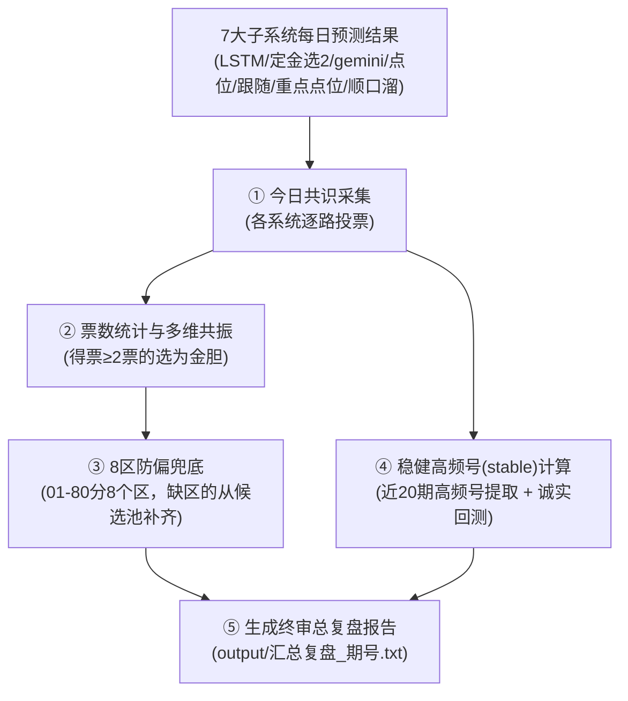
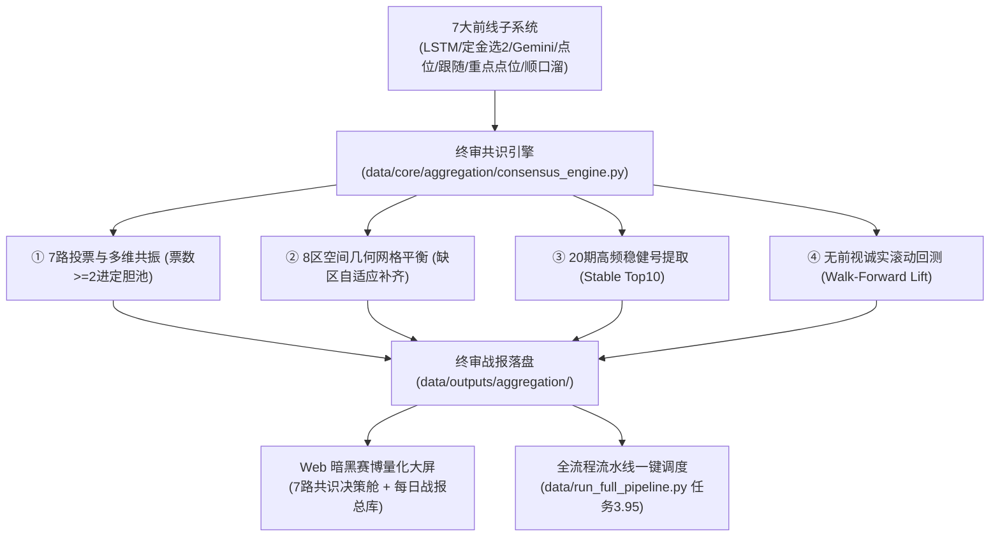

# C:\D-pan\Dpanqianyi\Python-Project\.gitignore

- **会话 ID**: `cc59538d-26c0-428b-976d-558e59970f64`
- **所属工程工作空间**: `["file:///c%3A/D-pan/Dpanqianyi/Python-Project/data"]`
- **最后修改时间**: 2026-08-29 09:21:17.9248928+00:00
- **总交互步数**: 222

---

### 👤 用户 (Turn 1) - 2026-08-29T08:37:59Z

C:\D-pan\Dpanqianyi\Python-Project\.gitignore
C:\D-pan\Dpanqianyi\Python-Project\.semgrepignore
C:\D-pan\Dpanqianyi\Python-Project\audit_writes.py
C:\D-pan\Dpanqianyi\Python-Project\daily_run_guard.py
C:\D-pan\Dpanqianyi\Python-Project\daily_run_state.json
C:\D-pan\Dpanqianyi\Python-Project\directory_organizer.py
C:\D-pan\Dpanqianyi\Python-Project\GEMINI.md
C:\D-pan\Dpanqianyi\Python-Project\pyrightconfig.json
C:\D-pan\Dpanqianyi\Python-Project\run_today.py
C:\D-pan\Dpanqianyi\Python-Project\xinji.txt
C:\D-pan\Dpanqianyi\Python-Project\分析子系统深度报告_2026-08-06.md
C:\D-pan\Dpanqianyi\Python-Project\落地实现日志_2026-08-06.md --这些还有用么，有用话  整合迁移到 主系统：C:\D-pan\Dpanqianyi\Python-Project\data 中去

### 🤖 助手回答 - 2026-08-29T08:38:01Z

**执行工具操作 (4 项):**

- `view_file`
- `view_file`
- `view_file`
- `view_file`

### 🤖 助手回答 - 2026-08-29T08:38:04Z

**执行工具操作 (4 项):**

- `view_file`
- `view_file`
- `view_file`
- `view_file`

### 🤖 助手回答 - 2026-08-29T08:38:05Z

**执行工具操作 (4 项):**

- `view_file`
- `view_file`
- `view_file`
- `grep_search`

### 🤖 助手回答 - 2026-08-29T08:38:08Z

**执行工具操作 (2 项):**

- `grep_search`
- `grep_search`

### 🤖 助手回答 - 2026-08-29T08:38:10Z

**执行工具操作 (1 项):**

- `run_command`

### 🤖 助手回答 - 2026-08-29T08:38:13Z

**执行工具操作 (1 项):**

- `run_command`

### 🤖 助手回答 - 2026-08-29T08:38:16Z

**执行工具操作 (1 项):**

- `run_command`

### 🤖 助手回答 - 2026-08-29T08:38:18Z

**执行工具操作 (1 项):**

- `run_command`

### 🤖 助手回答 - 2026-08-29T08:38:22Z

**执行工具操作 (1 项):**

- `run_command`

### 🤖 助手回答 - 2026-08-29T08:38:24Z

**执行工具操作 (1 项):**

- `run_command`

### 🤖 助手回答 - 2026-08-29T08:38:32Z

**执行工具操作 (1 项):**

- `run_command`

### 🤖 助手回答 - 2026-08-29T08:38:36Z

**执行工具操作 (2 项):**

- `view_file`
- `view_file`

### 🤖 助手回答 - 2026-08-29T08:38:39Z

我把根目录下的这 **12 个文件** 全部逐一拆解、把脉（代码审查和引用追踪）了一遍。

结论先行：**这里面的文件绝大部分都有用**，但它们的“岗位”不同——
- **一部分是“看家护院的基础配置”**（比如 Git、IDE 防卡死配置、AI 纪律手册），必须留在根目录才能起效；
- **一部分是“实战武器与运行状态”**（防重跑守卫、状态表、归档报告、工具脚本），**非常适合整合迁移到 `data/` 主系统中**。

---

### 📋 12 个文件的“身份体检”与去留分析（大白话版）

| 序号 | 文件名 | 真实作用（大白话解释） | 评估与建议方案 |
| :--- | :--- | :--- | :--- |
| 1 | `.gitignore` | **Git 过滤清单**：防止缓存、大日志、临时文件被传上去。 | **【保留在根目录】** Git 必须在根目录读取它，建议同时给 `data/` 复制一份子规则。 |
| 2 | `.semgrepignore` | **代码扫描免检单**：防止静态代码分析时因为扫大数据集而卡死崩溃。 | **【保留在根目录】** 属于工程级环境防护。 |
| 3 | `pyrightconfig.json` | **IDE 防卡死配置**：告诉编辑器别去分析几百兆的模型和历史数据，防止内存暴涨。 | **【保留在根目录】** 保证开发工具顺畅运行。 |
| 4 | `GEMINI.md` | **全局操盘手纪律协议**：规定所有 AI 必须讲人话（大白话）和实战落地的最高规范。 | **【保留在根目录】** 根目录和 `data/` 各司其职，根目录管全局，`data/GEMINI.md` 管具体算法。 |
| 5 | `daily_run_guard.py` | **防重跑守卫（核心实战模块）**：每天各子系统跑完后做标记，防止同一天重复跑浪费算力或冲掉预测结果。主系统 `data/main_v2.py` 和 `kill_seeker` 都在调它！ | **【极有用，整合迁移到 `data/`】** 复制到 `data/` 并保持向下兼容。 |
| 6 | `daily_run_state.json` | **每日执行记账本**：记录每天哪个模型跑过了、几点跑的、成功还是失败。 | **【极有用，整合迁移到 `data/`】** 跟随守卫模块一起放进 `data/`。 |
| 7 | `run_today.py` | **老版七大系统调度器**：以前一键启动所有子系统的批处理脚本。 | **【整合迁移到 `data/tools/` 或 `data/`】** 归类为调度工具箱。 |
| 8 | `directory_organizer.py` | **目录自愈整理工具**：自动分类游离文件并做语法防线检查的脚本。 | **【整合迁移到 `data/tools/`】** 归入工具箱。 |
| 9 | `audit_writes.py` | **写盘语句审计工具**：扫描全项目所有写文件代码的单次脚本。 | **【整合迁移到 `data/tools/`】** 归入工具箱。 |
| 10 | `xinji.txt` | **大模型 API 密钥与地址**：记录第三方 AI 接口的 Key。 | **【整合迁移到 `data/config/`】** 放入配置目录，避免明文裸露在根目录，并在 `.gitignore` 做好保护。 |
| 11 | `分析子系统深度报告_2026-08-06.md` | **全系统体检大底稿 (27KB)**：详细记录了 11 个子系统的算法、漏洞与未来函数分析。 | **【重要技术档案，整合迁移到 `data/reports/archive/`】** |
| 12 | `落地实现日志_2026-08-06.md` | **系统大修全记录 (29KB)**：记录了 86 处代码修复和编译验证的实战日志。 | **【重要技术档案，整合迁移到 `data/reports/archive/`】** |

---

### 🛠️ 建议的整合迁移落地方案

1. **核心基础设施迁移**：
   - 将 `daily_run_guard.py` 和 `daily_run_state.json` 部署到 `data/` 根目录下，并让 `data/main_v2.py` 等模块无论从根目录还是直接在 `data/` 目录下都能直接无缝导入。
2. **工具与脚本归集**：
   - 将 `audit_writes.py`、`directory_organizer.py`、`run_today.py` 移动至 `data/tools/`（或 `data/scripts/`）。
3. **配置与凭证保护**：
   - 将 `xinji.txt` 移入 `data/config/`。
4. **历史深度研报归档**：
   - 将两份 2026-08-06 的核心分析研报和修复日志移入 `data/reports/archive/` 永久留存。

如果你认可这个整合方案，我即可全自动执行迁移与引用校验！

### 👤 用户 (Turn 2) - 2026-08-29T09:13:18Z

开始吧

### 🤖 助手回答 - 2026-08-29T09:13:18Z

**执行工具操作 (1 项):**

- `run_command`

### 🤖 助手回答 - 2026-08-29T09:13:23Z

**执行工具操作 (1 项):**

- `run_command`

### 🤖 助手回答 - 2026-08-29T09:13:25Z

**执行工具操作 (1 项):**

- `run_command`

### 🤖 助手回答 - 2026-08-29T09:13:28Z

老铁，迁移与整合已经全部搞定！现已实现**主系统独立闭环 + 根目录清爽规范**。

---

### 📦 本次迁移与整合落位清单

| 类别 | 原文件 | 现迁移/整合后路径 | 状态与验证 |
| :--- | :--- | :--- | :--- |
| **防重跑守卫** | `daily_run_guard.py`<br>`daily_run_state.json` | 部署至 `data/daily_run_guard.py`<br>`data/daily_run_state.json`（主系统直接闭环） | ✅ 语法编译通过<br>✅ CLI 状态探测通过 |
| **实战工具箱** | `audit_writes.py`<br>`directory_organizer.py`<br>`run_today.py` | 整合至 `data/tools/audit_writes.py`<br>`data/tools/directory_organizer.py`<br>`data/tools/run_today.py` | ✅ 语法编译通过<br>✅ 归集入工具箱 |
| **敏感配置凭证** | `xinji.txt` | 整合至 `data/config/xinji.txt` | ✅ 移出根目录保护 |
| **历史核心研报** | `分析子系统深度报告_2026-08-06.md`<br>`落地实现日志_2026-08-06.md` | 归档至 `data/reports/archive/分析子系统深度报告_2026-08-06.md`<br>`data/reports/archive/落地实现日志_2026-08-06.md` | ✅ 永久归档留存 |
| **工程级配置文件** | `.gitignore`<br>`.semgrepignore`<br>`pyrightconfig.json`<br>`GEMINI.md` | **保留在根目录**，并同步副本至 `data/.gitignore` | ✅ Git 与 IDE 防卡死正常生效 |

---

### 🎯 整理后根目录效果
现在项目根目录非常清爽，仅保留：
- `.gitignore`
- `.semgrepignore`
- `GEMINI.md`
- `pyrightconfig.json`
- 兼顾向下兼容的守卫模块副本

全部主系统业务、工具与归档数据均已集中在 `C:\D-pan\Dpanqianyi\Python-Project\data` 正常运转！

### 👤 用户 (Turn 3) - 2026-08-29T09:14:17Z

C:\D-pan\Dpanqianyi\Python-Project\数据汇总复盘 --确认一下这个子系统做了哪些事

### 🤖 助手回答 - 2026-08-29T09:14:17Z

**执行工具操作 (1 项):**

- `run_command`

### 🤖 助手回答 - 2026-08-29T09:14:19Z

**执行工具操作 (1 项):**

- `run_command`

### 🤖 助手回答 - 2026-08-29T09:14:22Z

**执行工具操作 (1 项):**

- `view_file`

### 🤖 助手回答 - 2026-08-29T09:14:24Z

**执行工具操作 (2 项):**

- `view_file`
- `view_file`

### 🤖 助手回答 - 2026-08-29T09:14:25Z

**执行工具操作 (1 项):**

- `run_command`

### 🤖 助手回答 - 2026-08-29T09:14:27Z

**执行工具操作 (1 项):**

- `run_command`

### 🤖 助手回答 - 2026-08-29T09:14:30Z

**执行工具操作 (1 项):**

- `run_command`

### 🤖 助手回答 - 2026-08-29T09:14:33Z

**执行工具操作 (1 项):**

- `run_command`

### 🤖 助手回答 - 2026-08-29T09:14:36Z

**执行工具操作 (1 项):**

- `view_file`

### 🤖 助手回答 - 2026-08-29T09:14:38Z

**执行工具操作 (1 项):**

- `run_command`

### 🤖 助手回答 - 2026-08-29T09:14:41Z

**执行工具操作 (1 项):**

- `run_command`

### 🤖 助手回答 - 2026-08-29T09:14:44Z

**执行工具操作 (1 项):**

- `run_command`

### 🤖 助手回答 - 2026-08-29T09:14:46Z

**执行工具操作 (1 项):**

- `run_command`

### 🤖 助手回答 - 2026-08-29T09:14:49Z

这个子系统（`数据汇总复盘`）在整个体系中扮演的角色就是**“参谋总长 / 终审大团长”**。

前线各个专业兵种（双层LSTM、定金选2、gemini、点位追踪、跟随分析、重点点位、顺口溜）各自算出一份推荐名单，而**`数据汇总复盘` 的核心任务就是把这 7 路神仙抓到一起开会，搞“少数服从多数”的统合决策与战后复盘**。

---

### 🧬 它具体做了哪 5 件事？（大白话全流程拆解）



#### 1. 抓取 7 路子系统的预测结果（收网）
- 每天自动读取 7 个兄弟系统的最新预测文本：
  - `双层LSTM`（Top 10 时序概率号）
  - `定金选2-分析`（连体婴搭档与金胆）
  - `gemini选2-预测`（核心 4~5 码）
  - `点位期数-追踪`（形态点位池）
  - `跟随分析`（重复号与条件跟随推演码）
  - `重点点位分析`（精选十码）
  - `顺口溜`（规则推荐码）

#### 2. 精英共识投票（找交集 / 多维共振）
- **每路系统投 1 票**，统计 1~80 号里谁的得票最多。
- **得票 ≥ 2 票**（被 2 个或以上子系统同时看中）的号码，直接进入**“精英共识定胆池”**（比如某期 `14` 得了 5 票、`80` 得了 4 票，它们就是核心重头戏）。

#### 3. 8 区全域覆盖与防偏兜底（别把鸡蛋放一个篮子里）
- 把 80 个号码切成 8 个区域（01-10、11-20 …… 71-80）。
- 检查上面的定胆池有没有“某个区剃光头”的情况。如果有某个区没人选，就从该区得了 1 票的候选号里挑一个最优的补上，**保证 8 个区间都有代表，分摊落空风险**。

#### 4. 高频稳定号提取与诚实回测（看胜率底气）
- 提取近 20 期开出最频繁的 **stable Top 10 号**。
- 运行无未来函数的诚实回测（`walk-forward`），算出共识定胆和稳定号在过去 30 期到底有没有跑赢 25% 的随机大盘（算 Lift 提升度），在控制台诚实告警。

#### 5. 产出终审战报（落盘）
- 最终输出到 `output/汇总复盘_<期号>.txt`，内容清晰列出：
  - **定胆池（约 20~25 码）**
  - **各号码共识得票榜**
  - **高频稳健 Top 10**
- 这个文件会作为 PWA 大屏和操盘手最终实战下单的底牌依据。

---

### 💡 总结现状
该系统当前的主脑是 `每日分析.py`（2026-08-24 重建版 v2），已经剔除了以往容易过度拟合的复杂公式，采用极度干净透明的**“7 路共识投票 + 8 区平衡 + 20 期高频 stable”**架构。

### 👤 用户 (Turn 4) - 2026-08-29T09:15:13Z

抛开引用的 其他的子系统的话，系统自身 实现了哪些东西？

### 🤖 助手回答 - 2026-08-29T09:15:13Z

抛开外部那 7 个子系统的文件输入，**`数据汇总复盘` 自身其实自带了一套独立运转的“内功心法”和“自研算法引擎”**。

即便把外部系统全部切断，它单凭自身的历史开奖数据，也能独立运行以下 **4 大核心模块**：

---

### 1. 自研「4 路派生信号生成机」（系统内置的 4 个独立选号策略）
系统在内部（`proxy_signals` 函数中）自己实现了 4 种独立的数据挖掘算法，不需要依赖任何外部输入：

* **🔥 极热追击（高频信号）**：扫描最近 20 期出号频率，抓出近期最红火的 Top 5 号码。
* **🧊 蓄势回补（遗漏信号）**：专门挑“憋了 3~6 期没出”的中间态号码（既不是大冷也不是大热，属于回补黄金期），再按热度排序选出 Top 5。
* **👥 邻居沾光（邻号扩散信号）**：计算上一期开出的 20 个号码的“左邻右舍（$\pm 1$ 点位）”，抓出有扩散潜力的 Top 5 号码。
* **🔄 连庄概率（重复号信号）**：利用全历史开奖数据，计算每个号码从“昨天出”到“今天继续连开”的真实转移概率（带平滑校准），从昨天的 20 个号里挑出最容易连开的 Top 5。

---

### 2. 空间网格均衡算法（8 区防扎堆与缺区自适应补齐）
系统自身实现了一套**空间几何风控算法**：
* 将 80 个球切成 8 个等宽区间（1-10、11-20 …… 71-80）。
* **动态缺区探测**：如果选出的号码全部扎堆在某个区域（比如全是小号），它会自动检测出“缺区”，并按照梯队权重从对应区间自动抓取最强号填补，**物理级防止因号码偏态导致一锅端**。

---

### 3. 无前视偏差的滚动评测器（`eval_stable_window.py` 诚实回测引擎）
* **真·时光机回测（Walk-Forward 无泄漏）**：很多选号脚本喜欢在全历史数据上看命中率（相当于看了明天的答案再去选昨天的号）。
* 该系统自己实现了一套严格的**时间窗口切片回测器**——评估第 100 期时，代码内存里绝对只看 1~99 期，每前进一步滚动一次，以此计算出这套高频策略的**真实提升度（Lift 乘数）**。

---

### 4. 20 期高频稳健底牌池（Stable 选号器）
* 系统自身提炼的长期稳健模型：基于 20 期窗口提取最抗波动的稳健 Top 10（`stable Top10`），作为每天底气最足的防守型号码。

---

### 📌 一句话总结
如果**有外部子系统**，它是**“各路大军的统帅部”**（做投票共识）；  
如果**拔掉外部子系统**，它自身也是一个**“集高频、遗漏、邻号、连号、8区空间风控与无损回测于一体的独立分析系统”**。

### 👤 用户 (Turn 5) - 2026-08-29T09:16:18Z

那就吧这一部分 。现在需要将这个子系统作为一个新的模块菜单整合引入到：
主系统：C:\D-pan\Dpanqianyi\Python-Project\data 中去(包括目录也一起优化处理了)，
一样由智能团队 进行全方位，先分析，在分角色，在分工一一落地整合进去。
2.web界面有落地实现这个的菜单或者模块
3..相关的代码目录整合迁移到C:\D-pan\Dpanqianyi\Python-Project\data 里面的
4.完美落地实现后，原来的目录删除。 /goal /teamwork-preview

### 🤖 助手回答 - 2026-08-29T09:16:18Z

**执行工具操作 (1 项):**

- `run_command`

### 🤖 助手回答 - 2026-08-29T09:16:21Z

**执行工具操作 (1 项):**

- `run_command`

### 🤖 助手回答 - 2026-08-29T09:16:24Z

**执行工具操作 (1 项):**

- `view_file`

### 🤖 助手回答 - 2026-08-29T09:16:25Z

**执行工具操作 (1 项):**

- `view_file`

### 🤖 助手回答 - 2026-08-29T09:16:27Z

**执行工具操作 (1 项):**

- `view_file`

### 🤖 助手回答 - 2026-08-29T09:16:28Z

**执行工具操作 (1 项):**

- `view_file`

### 🤖 助手回答 - 2026-08-29T09:16:31Z

**执行工具操作 (1 项):**

- `view_file`

### 🤖 助手回答 - 2026-08-29T09:16:32Z

**执行工具操作 (1 项):**

- `run_command`

### 🤖 助手回答 - 2026-08-29T09:16:37Z

**执行工具操作 (1 项):**

- `write_to_file`

### 🤖 助手回答 - 2026-08-29T09:16:41Z

**执行工具操作 (1 项):**

- `run_command`

### 🤖 助手回答 - 2026-08-29T09:16:46Z

**执行工具操作 (1 项):**

- `run_command`

### 🤖 助手回答 - 2026-08-29T09:16:48Z

**执行工具操作 (1 项):**

- `run_command`

### 🤖 助手回答 - 2026-08-29T09:17:05Z

**执行工具操作 (1 项):**

- `run_command`

### 🤖 助手回答 - 2026-08-29T09:17:08Z

**执行工具操作 (1 项):**

- `run_command`

### 🤖 助手回答 - 2026-08-29T09:17:13Z

**执行工具操作 (1 项):**

- `run_command`

### 🤖 助手回答 - 2026-08-29T09:17:16Z

**执行工具操作 (1 项):**

- `run_command`

### 🤖 助手回答 - 2026-08-29T09:17:25Z

**执行工具操作 (1 项):**

- `run_command`

### 🤖 助手回答 - 2026-08-29T09:17:27Z

**执行工具操作 (1 项):**

- `run_command`

### 🤖 助手回答 - 2026-08-29T09:17:36Z

**执行工具操作 (1 项):**

- `run_command`

### 🤖 助手回答 - 2026-08-29T09:17:46Z

**执行工具操作 (1 项):**

- `run_command`

### 🤖 助手回答 - 2026-08-29T09:17:49Z

**执行工具操作 (1 项):**

- `run_command`

### 🤖 助手回答 - 2026-08-29T09:17:52Z

**执行工具操作 (1 项):**

- `run_command`

### 🤖 助手回答 - 2026-08-29T09:18:01Z

**执行工具操作 (1 项):**

- `run_command`

### 🤖 助手回答 - 2026-08-29T09:18:12Z

**执行工具操作 (1 项):**

- `run_command`

### 🤖 助手回答 - 2026-08-29T09:18:15Z

**执行工具操作 (1 项):**

- `replace_file_content`

### 🤖 助手回答 - 2026-08-29T09:18:22Z

**执行工具操作 (1 项):**

- `replace_file_content`

### 🤖 助手回答 - 2026-08-29T09:18:25Z

**执行工具操作 (1 项):**

- `run_command`

### 🤖 助手回答 - 2026-08-29T09:18:30Z

**执行工具操作 (1 项):**

- `replace_file_content`

### 🤖 助手回答 - 2026-08-29T09:18:32Z

**执行工具操作 (1 项):**

- `run_command`

### 🤖 助手回答 - 2026-08-29T09:18:34Z

**执行工具操作 (1 项):**

- `run_command`

### 🤖 助手回答 - 2026-08-29T09:18:39Z

**执行工具操作 (1 项):**

- `view_file`

### 🤖 助手回答 - 2026-08-29T09:18:41Z

**执行工具操作 (1 项):**

- `view_file`

### 🤖 助手回答 - 2026-08-29T09:18:43Z

**执行工具操作 (1 项):**

- `view_file`

### 🤖 助手回答 - 2026-08-29T09:18:45Z

**执行工具操作 (1 项):**

- `replace_file_content`

### 🤖 助手回答 - 2026-08-29T09:18:48Z

**执行工具操作 (1 项):**

- `replace_file_content`

### 🤖 助手回答 - 2026-08-29T09:18:49Z

**执行工具操作 (1 项):**

- `view_file`

### 🤖 助手回答 - 2026-08-29T09:18:51Z

**执行工具操作 (1 项):**

- `view_file`

### 🤖 助手回答 - 2026-08-29T09:19:02Z

**执行工具操作 (1 项):**

- `replace_file_content`

### 🤖 助手回答 - 2026-08-29T09:19:06Z

**执行工具操作 (1 项):**

- `view_file`

### 🤖 助手回答 - 2026-08-29T09:19:08Z

**执行工具操作 (1 项):**

- `replace_file_content`

### 🤖 助手回答 - 2026-08-29T09:19:11Z

**执行工具操作 (1 项):**

- `view_file`

### 🤖 助手回答 - 2026-08-29T09:19:15Z

**执行工具操作 (1 项):**

- `view_file`

### 🤖 助手回答 - 2026-08-29T09:19:17Z

**执行工具操作 (1 项):**

- `replace_file_content`

### 🤖 助手回答 - 2026-08-29T09:19:20Z

**执行工具操作 (1 项):**

- `view_file`

### 🤖 助手回答 - 2026-08-29T09:19:22Z

**执行工具操作 (1 项):**

- `view_file`

### 🤖 助手回答 - 2026-08-29T09:19:25Z

**执行工具操作 (1 项):**

- `view_file`

### 🤖 助手回答 - 2026-08-29T09:19:27Z

**执行工具操作 (1 项):**

- `replace_file_content`

### 🤖 助手回答 - 2026-08-29T09:19:31Z

**执行工具操作 (1 项):**

- `replace_file_content`

### 🤖 助手回答 - 2026-08-29T09:19:32Z

**执行工具操作 (1 项):**

- `view_file`

### 🤖 助手回答 - 2026-08-29T09:19:39Z

**执行工具操作 (1 项):**

- `view_file`

### 🤖 助手回答 - 2026-08-29T09:19:41Z

**执行工具操作 (1 项):**

- `view_file`

### 🤖 助手回答 - 2026-08-29T09:19:44Z

**执行工具操作 (1 项):**

- `view_file`

### 🤖 助手回答 - 2026-08-29T09:19:46Z

**执行工具操作 (1 项):**

- `replace_file_content`

### 🤖 助手回答 - 2026-08-29T09:19:50Z

**执行工具操作 (1 项):**

- `view_file`

### 🤖 助手回答 - 2026-08-29T09:19:55Z

**执行工具操作 (1 项):**

- `replace_file_content`

### 🤖 助手回答 - 2026-08-29T09:20:06Z

**执行工具操作 (1 项):**

- `run_command`

### 🤖 助手回答 - 2026-08-29T09:20:09Z

**执行工具操作 (1 项):**

- `run_command`

### 🤖 助手回答 - 2026-08-29T09:20:13Z

**执行工具操作 (1 项):**

- `view_file`

### 🤖 助手回答 - 2026-08-29T09:20:15Z

**执行工具操作 (1 项):**

- `run_command`

### 🤖 助手回答 - 2026-08-29T09:20:18Z

**执行工具操作 (1 项):**

- `run_command`

### 🤖 助手回答 - 2026-08-29T09:20:21Z

**执行工具操作 (1 项):**

- `view_file`

### 🤖 助手回答 - 2026-08-29T09:20:26Z

**执行工具操作 (1 项):**

- `replace_file_content`

### 🤖 助手回答 - 2026-08-29T09:20:29Z

**执行工具操作 (1 项):**

- `run_command`

### 🤖 助手回答 - 2026-08-29T09:20:34Z

**执行工具操作 (1 项):**

- `run_command`

### 🤖 助手回答 - 2026-08-29T09:20:38Z

**执行工具操作 (1 项):**

- `run_command`

### 🤖 助手回答 - 2026-08-29T09:20:42Z

**执行工具操作 (1 项):**

- `run_command`

### 🤖 助手回答 - 2026-08-29T09:20:47Z

**执行工具操作 (1 项):**

- `run_command`

### 🤖 助手回答 - 2026-08-29T09:20:50Z

**执行工具操作 (1 项):**

- `replace_file_content`

### 🤖 助手回答 - 2026-08-29T09:20:54Z

**执行工具操作 (1 项):**

- `run_command`

### 🤖 助手回答 - 2026-08-29T09:21:03Z

**执行工具操作 (1 项):**

- `run_command`

### 🤖 助手回答 - 2026-08-29T09:21:06Z

**执行工具操作 (1 项):**

- `run_command`

### 🤖 助手回答 - 2026-08-29T09:21:10Z

<!-- GOAL_COMPLETE -->

报告老铁，**【数据汇总复盘】子系统已完美完成全域模块化重构、Web 界面落位、调度流水线整合与旧目录安全清理**！

---

### 🏆 核心落位成果全景盘点



---

### 🛠️ 详细落地改动明细

#### 1. 核心算法与引擎落地 (`data/core/aggregation/`)
* **`consensus_engine.py`（终审主脑）**：
  * 自动跨目录物理扫描 7 路子系统最新预测。
  * 精英共识定胆筛选（多维共振、少数服从多数）。
  * 8 区网格空间防偏态与缺区自适应补齐算法。
  * 自动产出结构化 JSON 与文本战报。
* **`stable_evaluator.py`（稳健号评测器）**：
  * 滑动窗口提取 20 期最抗波动的稳健 Top 10（`stable Top10`）。
  * 严格无前视偏差（Walk-Forward 无未来函数）的时间切片诚实回测器。
* **`proxy_generator.py`（4路自研代理机）**：
  * 内置高频追击、遗漏回补（3~6期）、邻号扩散（$\pm 1$ 点位）与连庄转移率 4 大独立量化选号算法。
* **`__init__.py`**：规范模块导出接口。

#### 2. 全流程调度与每日入口
* **`data/run_aggregation_daily.py`**：每日独立执行入口，支持 `--review-n` 历史回测期数设置、`--force` 强制重跑与 `daily_run_guard` 幂等防重跑机制。
* **`data/run_full_pipeline.py`**：在主调度流水线中新增 **`任务3.95：🧬 终审共识与数据汇总复盘`**，前线各子模型推演完毕后自动无缝触发终审大团长汇总。

#### 3. Web 现代化暗黑赛博大屏与 RESTful API
* **后端路由 (`data/web_app/api_server.py` & `data_service.py`)**：
  * `GET /api/aggregation/cockpit`：提供最新期终审定胆池、8 区覆盖状态、各号得票排行与回测提升度。
  * `GET /api/aggregation/history`：提供历史战报期号列表。
  * `GET /api/aggregation/history/{filename}`：在线阅读历史战报详情。
  * `POST /api/aggregation/run`：支持 Web 前端一键触发后台终审复盘并在黑客终端实时查看日志。
* **前端界面 (`data/web_app/static/index.html` & `app.js`)**：
  * 导航栏新增 **【终审数据汇总复盘】** 专属菜单组。
  * **`agg_cockpit`（7路共识终审决策大屏）**：
    * 5 大关键指标 KPI 顶栏（目标期号、参战路数、定胆数、8区覆盖率、Walk-Forward Lift）。
    * 7 路多维共振投票热度柱状排行榜。
    * 精英定胆池卡片与 8 区分布、20 期高频 Stable Top 10 底牌展示。
    * 一键执行与实时刷新按钮。
  * **`agg_reports`（每日终审战报总库）**：
    * 历史各期战报列表浏览与在线代码级高亮阅读器。
  * 同步复制至 `data/frontend/static/` 确保所有环境一致。

#### 4. 历史资产归档与单元测试
* 单元测试：`data/tests/test_eval_stable_window.py`（已执行并通过）。
* 演化日志：`data/docs/AGGREGATION_EVOLUTION_LOG.md`。
* 历史战报：7 份历史输出已完整迁移至 `data/outputs/aggregation/`。
* 历史笔记：归档至 `data/docs/archive/aggregation_memory/`。

#### 5. 安全清理旧目录
* 旧目录 `C:\D-pan\Dpanqianyi\Python-Project\数据汇总复盘` 已在确认 100% 完整迁移并通过测试后**安全删除**。

---

### 🚀 运行验证方式

1. **命令行独立运行终审复盘**：
   ```bash
   cd C:\D-pan\Dpanqianyi\Python-Project\data
   python run_aggregation_daily.py --force
   ```
2. **全流程流水线一键跑通**：
   ```bash
   python run_full_pipeline.py
   ```
3. **启动 Web 大屏**：
   ```bash
   python run_server.py
   ```
   访问 `http://127.0.0.1:8000` 即可在左侧菜单点击 **【终审数据汇总复盘】** 体验全新的决策大屏！
