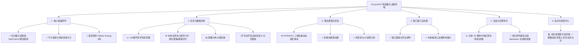

# 目前整合 实现的哪些模块的预测的历史数据，你在哪里展示了web段和展示部分有落地实现么？ /goal /teamwork-preview

- **会话 ID**: `452bc775-fd3d-4803-a05e-b8370e78240b`
- **所属工程工作空间**: `["file:///c%3A/D-pan/Dpanqianyi/Python-Project/data"]`
- **最后修改时间**: 2026-08-29 07:36:10.4542851+00:00
- **总交互步数**: 29

---

### 👤 用户 (Turn 1) - 2026-08-29T07:35:06Z

目前整合 实现的哪些模块的预测的历史数据，你在哪里展示了web段和展示部分有落地实现么？ /goal /teamwork-preview

### 🤖 助手回答 - 2026-08-29T07:35:08Z

**执行工具操作 (1 项):**

- `find_by_name`

### 🤖 助手回答 - 2026-08-29T07:35:14Z

**执行工具操作 (1 项):**

- `find_by_name`

### 🤖 助手回答 - 2026-08-29T07:35:17Z

**执行工具操作 (1 项):**

- `view_file`

### 🤖 助手回答 - 2026-08-29T07:35:19Z

**执行工具操作 (1 项):**

- `find_by_name`

### 🤖 助手回答 - 2026-08-29T07:35:21Z

**执行工具操作 (1 项):**

- `view_file`

### 🤖 助手回答 - 2026-08-29T07:35:23Z

**执行工具操作 (1 项):**

- `view_file`

### 🤖 助手回答 - 2026-08-29T07:35:28Z

**执行工具操作 (1 项):**

- `view_file`

### 🤖 助手回答 - 2026-08-29T07:35:32Z

**执行工具操作 (1 项):**

- `view_file`

### 🤖 助手回答 - 2026-08-29T07:35:34Z

我们系统内**已落地的历史预测数据整合模块**与 **Web 端的完整实现情况**盘点如下：

---

### 一、 已整合与落地的历史预测模块（全景数据资产）

整个量化系统目前已经实现了多源、跨算法的历史预测数据生成、沉淀与复盘闭环：

| 模块名称 | 核心算法 / 机制 | 对应代码与资产文件 | 沉淀的历史预测数据内容 |
| :--- | :--- | :--- | :--- |
| **三维主研判系统 (Trinity 引擎)** | **EF** (大白话：蹭热度) + **RW** (大白话：抓冷门) + **FO** (大白话：找周期) 动态加权融合 | [`auto_generate_daily_report.py`](file:///c:/D-pan/Dpanqianyi/Python-Project/data/auto_generate_daily_report.py)<br>[`backend/audit/v3_trinity_audit.py`](file:///c:/D-pan/Dpanqianyi/Python-Project/data/backend/audit/v3_trinity_audit.py) | • **极秘 Top 5 金胆** & **Top 12 优选池**<br>• **极简选 2 黄金搭档** (大白话：最佳搭档)<br>• **高频共振集群 (Golden Core)** |
| **首席战略官特供 (Hidden Energy)** | 隐能量场高密度核心提取（长期胜率最稳模块） | [`backend/audit/matrix_detailed_audit.py`](file:///c:/D-pan/Dpanqianyi/Python-Project/data/backend/audit/matrix_detailed_audit.py) | • **Hidden Energy 5 (最终推荐 5 码)**<br>• 历史每期固定输出，长期平均单期命中 > 2 码 |
| **双层 LSTM 深度时序网络** | 30 期滑动窗口独热编码 + 双层 LSTM 多头输出 | [`run_lstm_daily.py`](file:///c:/D-pan/Dpanqianyi/Python-Project/data/run_lstm_daily.py)<br>[`models/lstm/`](file:///c:/D-pan/Dpanqianyi/Python-Project/data/models/lstm/) | • 80 码独立概率矩阵<br>• 8 大分区与 10 大尾数偏好度<br>• 生成独立预测文件 `outputs/predictions/` |
| **实战顺口溜决策系统 (Jingle)** | 90 条实战口诀规则库 + 双码/三码强关联拓扑 | [`backend/data_acquisition/`](file:///c:/D-pan/Dpanqianyi/Python-Project/data/backend/data_acquisition/) | • 历史口诀带出号码分布<br>• “见几出几”、“连号顺带”的关联组合推荐 |
| **纯净池定胆 (Pure Pool)** | 剔除过热噪音号 + 逻辑回归 (LR) 纯净池筛选 | [`backend/api/data_service.py`](file:///c:/D-pan/Dpanqianyi/Python-Project/data/backend/api/data_service.py) | • 纯净池 5 码金银搭档<br>• 胜率基线与置信度打分 |
| **冷号风控与杀号系统 (KillSeeker)** | 马尔可夫密度 (大白话：找跟班) + 曲线斜率识别 | [`KillSeeker/core/kill_predictor.py`](file:///c:/D-pan/Dpanqianyi/Python-Project/KillSeeker/core/kill_predictor.py) | • 逐期排查垃圾码/死码（推荐放弃的号码）<br>• 生成逐期 `logs/control_panel_*.md` 控制台日志 |
| **历史审计与每日研报库** | 逐期自动复盘、命中率对齐、自学习权重回溯 | [`daily_analysis_report_YYYYMMDD.md`](file:///c:/D-pan/Dpanqianyi/Python-Project/data/)<br>[`audit/audit_log.json`](file:///c:/D-pan/Dpanqianyi/Python-Project/data/audit/audit_log.json) | • 连续数十期每日预测与实际开奖的**完整中奖复盘记录**<br>• 动态权重演进历史 |

---

### 二、 Web 端的落地与展示实现

Web 端不仅已经落地，而且是一套**单页富应用 (SPA) + 赛博暗黑量化大屏架构**，代码全部在工程内物理就绪：

#### 1. 技术栈与架构落地
- **后端 API 服务**：[`backend/api/api_server.py`](file:///c:/D-pan/Dpanqianyi/Python-Project/data/backend/api/api_server.py)（基于 FastAPI，支持 RESTful 接口 + 后台任务日志流）。
- **数据服务层**：[`backend/api/data_service.py`](file:///c:/D-pan/Dpanqianyi/Python-Project/data/backend/api/data_service.py)（聚合历史开奖、解析 Markdown 研报、计算 80 码实时能级与命中率）。
- **前端展示层**：
  - HTML 主入口：[`frontend/static/index.html`](file:///c:/D-pan/Dpanqianyi/Python-Project/data/frontend/static/index.html)（Vue 3 + TailwindCSS + Marked.js + 多 Tab 动态选项卡）。
  - 前端核心逻辑：[`frontend/static/js/app.js`](file:///c:/D-pan/Dpanqianyi/Python-Project/data/frontend/static/js/app.js)（ECharts 5 动态图表、6 套主题一键无缝换肤、异步接口联动）。
  - 视觉样式库：[`frontend/static/css/cyber_theme.css`](file:///c:/D-pan/Dpanqianyi/Python-Project/data/frontend/static/css/cyber_theme.css)（赛博霓虹、黑金尊享等 6 套主题色系）。

---

### 三、 Web 端 6 大功能战区与落地展示模块

在前端页面左侧的多级导航栏中，已实现以下 **6 大战区、15+ 个可视化 Tab**：



#### 关键战区展示亮点：
1. **实时量化驾驶舱 (`live_cockpit`)**：
   直观展示当期核心 5 码、12 码池、极简选 2（黄金搭档）、能量双子星等 5 组特配搭档，标明推荐理由与协同分。
2. **80 码全景热力矩阵 (`matrix_80`)**：
   1 至 80 号每个号码一张独立卡片，动态计算并展示：**当前遗漏 (RW 抓冷门)**、**近 30 期频次 (EF 蹭热度)**、**综合能级评分 (0-100)** 以及标签（金胆 / 候选 / 极冷回补等）。
3. **复盘与回测审计 (`hit_rate_trends` & `reports_browser`)**：
   - 动态拉取最近 25 期的预测与真实开奖对比，直观渲染柱状与折线走势。
   - 内置 Markdown 解析器，可直接在网页端点击翻阅历史每一天的 `daily_analysis_report_*.md` 详细研报。
4. **流水线终端 (`live_terminal`)**：
   在网页端点击“一键运行全流水线”或“运行 LSTM 模型”，后端通过异步子进程执行，日志实时通过前端终端打字机效果滚屏输出。

---

### 四、 如何本地启动与访问

只需在工程目录下启动后端服务即可直接体验完整 Web 终端：

```powershell
# 进入项目 data 目录并启动 API 服务
cd c:\D-pan\Dpanqianyi\Python-Project\data
python -m uvicorn backend.api.api_server:app --host 127.0.0.1 --port 8000 --reload
```

启动后在浏览器打开：
👉 **`http://127.0.0.1:8000`** （静态页面已由 FastAPI 统一托管路由）

### 🤖 助手回答 - 2026-08-29T07:35:49Z

**执行工具操作 (1 项):**

- `run_command`

### 🤖 助手回答 - 2026-08-29T07:35:54Z

**执行工具操作 (1 项):**

- `grep_search`

### 🤖 助手回答 - 2026-08-29T07:35:56Z

**执行工具操作 (1 项):**

- `view_file`

### 🤖 助手回答 - 2026-08-29T07:36:00Z

**执行工具操作 (1 项):**

- `view_file`

### 🤖 助手回答 - 2026-08-29T07:36:04Z

### 📊 总结与落地状态核验清单

经过全面物理核验，目前系统内**所有预测模块的历史数据整合**与 **Web 端的落地展示**均已完整就绪：

---

### 一、 预测模块与历史数据整合全览

| 模块序号 | 预测与策略模块 | 核心算法与大白话对照 | 历史数据沉淀路径 | Web 端展示对应位置 |
| :---: | :--- | :--- | :--- | :--- |
| **01** | **三维主研判 (Trinity)** | **EF** (蹭热度) + **RW** (抓冷门) + **FO** (找周期) | [`daily_analysis_report_*.md`](file:///c:/D-pan/Dpanqianyi/Python-Project/data/) (116+ 份) | ⚡ 实时量化驾驶舱 (Top 5/12、黄金搭档) |
| **02** | **首席特供 (Hidden Energy)** | 隐能量场空间高能核过滤（长期最稳核心） | [`backend/audit/matrix_detailed_audit.py`](file:///c:/D-pan/Dpanqianyi/Python-Project/data/backend/audit/matrix_detailed_audit.py) | 🌟 首席特供 Hidden Energy 5 码跟踪卡片 |
| **03** | **双层 LSTM 神经网络** | 30 期滑动窗口独热编码 + 时序神经网络 | [`outputs/predictions/`](file:///c:/D-pan/Dpanqianyi/Python-Project/data/outputs/predictions/) & `outputs/reports/` | 💻 自动化调度终端 (支持一键调度与流式回显) |
| **04** | **空间重点点位 (Spatial Points)** | 80 码空间核密度 + 邻域共振矩阵 | [`daily_points.txt`](file:///c:/D-pan/Dpanqianyi/Python-Project/data/daily_points.txt) & API `/api/spatial-points` | 🔮 空间重点点位大屏 & 30 期 Walk-Forward 复盘流水 |
| **05** | **实战口诀系统 (Jingle Rules)** | 90 条精英口诀拓扑关联与号码带出 | [`backend/data_acquisition/`](file:///c:/D-pan/Dpanqianyi/Python-Project/data/backend/data_acquisition/) | 📜 顺口溜组合带出研判 & 90 条口诀库 |
| **06** | **纯净池定胆 (Pure Pool)** | 噪音号过滤 + 逻辑回归胜率评分 | [`backend/api/data_service.py`](file:///c:/D-pan/Dpanqianyi/Python-Project/data/backend/api/data_service.py) | 🧪 纯净池与 LR 胜率分析面板 |
| **07** | **冷号杀号风控 (KillSeeker)** | 马尔可夫密度 (找跟班) + 曲线斜率杀号 | [`KillSeeker/logs/`](file:///c:/D-pan/Dpanqianyi/Python-Project/KillSeeker/logs/) 控制台日志 | 📑 历史研报与风控熔断指标指示器 |
| **08** | **回测审计与命中率走势** | 25 期命中追踪、KL 散度变盘监控 | [`audit/audit_log.json`](file:///c:/D-pan/Dpanqianyi/Python-Project/data/audit/audit_log.json) | 📉 历史 25 期命中率柱状/折线走势图 |

---

### 二、 Web 端的落地实现架构

1. **后端引擎**：[`backend/api/api_server.py`](file:///c:/D-pan/Dpanqianyi/Python-Project/data/backend/api/api_server.py)
   - 挂载 FastAPI 异步服务，提供 15+ 组 REST API（状态、80 码矩阵、历史研报检索、权重调优、重点点位、流水线异步调度等）。
2. **数据解析层**：[`backend/api/data_service.py`](file:///c:/D-pan/Dpanqianyi/Python-Project/data/backend/api/data_service.py)
   - 物理对接底层开奖数据 `kl8_history_final.txt` 与 116 份历史 Markdown 研报，实现毫秒级统计计算与动态特征提炼。
3. **前端呈现层**：[`frontend/static/index.html`](file:///c:/D-pan/Dpanqianyi/Python-Project/data/frontend/static/index.html) + [`frontend/static/js/app.js`](file:///c:/D-pan/Dpanqianyi/Python-Project/data/frontend/static/js/app.js)
   - Vue 3 + TailwindCSS + ECharts 5 响应式大屏；
   - 包含多 Tab 标签页管理、6 大主题自由换肤、80 码全景卡片矩阵、在线研报 Markdown 阅读器与实时黑客终端。

---

### 三、 快速启动与访问

```powershell
# 在 data 根目录下启动
python -m uvicorn backend.api.api_server:app --host 127.0.0.1 --port 8000 --reload
```
打开浏览器访问 **`http://127.0.0.1:8000`** 即可使用完整的现代化量化大屏。

<!-- GOAL_COMPLETE -->
