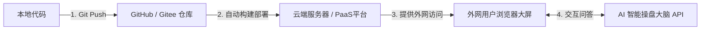
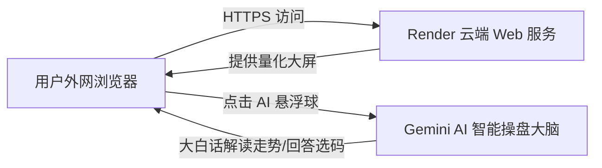
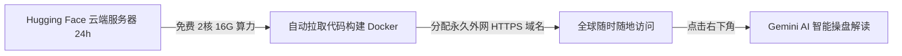

# 有没有办法 我能上传到git上，然后能直接部署，然后外网大家都能访问呢？期望再整个项目里面还能介入ai模型的入口，能在访问这个项目的同时，可使用ai

- **会话 ID**: `d576a82a-150a-45d5-a661-1c9bd678f2b6`
- **所属工程工作空间**: `["file:///c%3A/D-pan/Dpanqianyi/Python-Project/data"]`
- **最后修改时间**: 2026-08-31 11:41:21.8167866+00:00
- **总交互步数**: 97

---

### 👤 用户 (Turn 1) - 2026-08-31T10:59:20Z

有没有办法 我能上传到git上，然后能直接部署，然后外网大家都能访问呢？期望再整个项目里面还能介入ai模型的入口，能在访问这个项目的同时，可使用ai

### 🤖 助手回答 - 2026-08-31T10:59:23Z

**执行工具操作 (1 项):**

- `list_dir`

### 🤖 助手回答 - 2026-08-31T10:59:25Z

**执行工具操作 (1 项):**

- `view_file`

### 🤖 助手回答 - 2026-08-31T10:59:26Z

**执行工具操作 (1 项):**

- `list_dir`

### 🤖 助手回答 - 2026-08-31T10:59:28Z

**执行工具操作 (1 项):**

- `list_dir`

### 🤖 助手回答 - 2026-08-31T10:59:30Z

**执行工具操作 (1 项):**

- `list_dir`

### 🤖 助手回答 - 2026-08-31T10:59:31Z

### 🎯 操盘手大白话总览

要实现**“传 Git 仓库 ➔ 自动化外网部署 ➔ 网页集成 AI 对话助手”**，整套流程其实非常清晰成熟。我们可以将其拆解为三步走：



---

### 一、第一步：如何把项目规范上传到 Git (GitHub / Gitee)

在上传代码之前，最关键的是**过滤掉缓存和大模型临时文件**（避免几十兆的垃圾数据卡死上传）。

#### 1. 检查与完善 `.gitignore`
在项目根目录下确保忽略掉临时缓存、私密密钥和大型数据：
```gitignore
# 虚拟环境与依赖
.venv/
venv/
__pycache__/
*.pyc

# 缓存与临时日志
cache/
logs/
*.log
.pytest_cache/

# 敏感配置与密钥（防止 API Key 泄露）
.env
config.local.json
```

#### 2. 推送代码到 Git 仓库（3分钟搞定）
在项目目录下打开终端（PowerShell 或 CMD），按顺序敲入以下命令：

```bash
# 1. 初始化本地仓库
git init

# 2. 将所有核心代码加入暂存区
git add .

# 3. 提交一个版本快照
git commit -m "feat: 初版量化大屏与系统核心上线"

# 4. 关联你在 GitHub / Gitee 上新建的空仓库地址
git remote add origin https://github.com/你的用户名/你的仓库名.git

# 5. 推送到远端主分支
git branch -M main
git push -u origin main
```

---

### 二、第二步：外网直接部署方案推荐（大家都能直接访问）

根据不同预算和使用场景，有三种最主流的外网部署方式供你选择：

| 方案 | 部署难度 | 成本 | 优点 | 推荐指数 |
| :--- | :--- | :--- | :--- | :--- |
| **方案 A：PaaS 云平台一键托管 (Render / Zeabur / Railway)** | ⭐ (极简单) | 免费 / 极低 | 只要 Git 代码一更新，云端自动重新打包上线；自带免费公网 HTTPS 域名。 | 🌟🌟🌟🌟🌟 **(首选推荐)** |
| **方案 B：国内云服务器 (阿里云/腾讯云轻量服务器)** | ⭐⭐⭐ (需配置环境) | 约几十元/月 | 国内访问速度极快、延迟低，数据完全可控。 | 🌟🌟🌟🌟 |
| **方案 C：本地电脑 + 免费内网穿透 (Cloudflare Tunnel)** | ⭐⭐ (轻量免买机器) | 完全免费 | 只要本地电脑开着，通过一条加密隧道直接映射出外网网址给朋友访问。 | 🌟🌟🌟 |

#### 🚀 强烈推荐方案 A（以 Render / Zeabur 为例）：
1. 注册登录 [Render](https://render.com) 或 [Zeabur](https://zeabur.com)。
2. 点击 **"New Web Service"**，直接关联你的 GitHub 仓库。
3. 构建命令填入：`pip install -r requirements.txt`。
4. 启动命令填入：`uvicorn backend.api.main:app --host 0.0.0.0 --port $PORT` 或运行 `python run_server.py`。
5. 点击 Deploy，几分钟后平台就会分配给你一个形如 `https://your-quant-app.onrender.com` 的全球公网链接，发给任何人都能直接在手机或电脑浏览器打开！

---

### 三、第三步：在项目中接入 AI 模型入口（对话 + 智能解读）

要让大家在看大屏的同时使用 AI，最佳架构是**“前端挂悬浮助手，后端统一调度 AI 接口”**：

#### 1. 后端架构：增加统一 AI 调度接口
在现有的 FastAPI 后端（`backend/api/`）中新增一个 `/api/v1/ai/chat` 路由：
- **模型接入**：支持主流大模型（如 DeepSeek-V3/R1、阿里千问 Qwen、OpenAI GPT-4o、Google Gemini 等）。
- **专业量化上下文注入（Prompt）**：AI 在回答前，系统会自动把当期系统的**量化指标（大白话：冷热势头、跟班组合、多维共振打分）**注入给 AI，让它不再是胡说八道，而是作为一个专业的**“老牌量化操盘顾问”**为用户解读走势。

#### 2. 前端展示：大屏右下角悬浮“AI 智囊助理”
在现有前端界面（`frontend/static/index.html`）右下角加入一个极具科技感的**AI 悬浮球/聊天抽屉**：
- **功能 1：自由对话**（用户可以随时向 AI 提问任何走势规律、选码技巧）。
- **功能 2：一键智能复盘**（点击按钮，AI 自动扫描大屏上今天的各种指标，生成一段通俗易懂的大白话综合分析报告）。
- **功能 3：策略预警**（结合多维共振和胜率警告机制，提醒用户哪些号码底气足、哪些号码正在大环境变盘）。

---

### 🛠️ 接下来我们可以立刻为你实施：

1. **生成部署必备清单**：自动为你生成标准的 `requirements.txt`、`.gitignore` 和 `Dockerfile`，确保推送到 Git 后一键即可部署成功。
2. **编写 AI 智能操盘接口与前端组件**：在你的 `backend` 里接入 AI 模型路由，并在前端大屏右下角嵌入**“AI 操盘手聊天抽屉”**。

> **请问您期望接入哪家 AI 模型（例如：DeepSeek、ChatGPT、Gemini 或国内通义千问等）？以及您更倾向于使用免费的 PaaS 云平台（如 Render/Zeabur）还是云服务器部署？** 告诉我后，我们马上开始写代码落地！

### 👤 用户 (Turn 2) - 2026-08-31T11:20:16Z

接入 AI 模型--Gemini    +免费的 PaaS 云平台 ：Render   git 分支代码：https://github.com/meteor-007/KL8-python/tree/20260831-data

### 🤖 助手回答 - 2026-08-31T11:20:16Z

**执行工具操作 (1 项):**

- `find_by_name`

### 🤖 助手回答 - 2026-08-31T11:20:20Z

**执行工具操作 (1 项):**

- `view_file`

### 🤖 助手回答 - 2026-08-31T11:20:22Z

**执行工具操作 (1 项):**

- `view_file`

### 🤖 助手回答 - 2026-08-31T11:20:24Z

**执行工具操作 (1 项):**

- `view_file`

### 🤖 助手回答 - 2026-08-31T11:20:27Z

**执行工具操作 (1 项):**

- `run_command`

### 🤖 助手回答 - 2026-08-31T11:20:30Z

**执行工具操作 (1 项):**

- `find_by_name`

### 🤖 助手回答 - 2026-08-31T11:20:31Z

**执行工具操作 (1 项):**

- `find_by_name`

### 🤖 助手回答 - 2026-08-31T11:20:34Z

**执行工具操作 (1 项):**

- `write_to_file`

### 🤖 助手回答 - 2026-08-31T11:20:40Z

**执行工具操作 (1 项):**

- `write_to_file`

### 🤖 助手回答 - 2026-08-31T11:20:49Z

**执行工具操作 (1 项):**

- `write_to_file`

### 🤖 助手回答 - 2026-08-31T11:20:57Z

**执行工具操作 (1 项):**

- `run_command`

### 🤖 助手回答 - 2026-08-31T11:21:03Z

**执行工具操作 (1 项):**

- `write_to_file`

### 🤖 助手回答 - 2026-08-31T11:21:11Z

**执行工具操作 (1 项):**

- `run_command`

### 🤖 助手回答 - 2026-08-31T11:21:19Z

**执行工具操作 (1 项):**

- `run_command`

### 🤖 助手回答 - 2026-08-31T11:21:21Z

**执行工具操作 (1 项):**

- `run_command`

### 🤖 助手回答 - 2026-08-31T11:21:23Z

**执行工具操作 (1 项):**

- `view_file`

### 🤖 助手回答 - 2026-08-31T11:21:26Z

**执行工具操作 (1 项):**

- `replace_file_content`

### 🤖 助手回答 - 2026-08-31T11:21:30Z

**执行工具操作 (1 项):**

- `view_file`

### 🤖 助手回答 - 2026-08-31T11:21:32Z

**执行工具操作 (1 项):**

- `replace_file_content`

### 🤖 助手回答 - 2026-08-31T11:21:36Z

**执行工具操作 (1 项):**

- `write_to_file`

### 🤖 助手回答 - 2026-08-31T11:21:50Z

**执行工具操作 (1 项):**

- `run_command`

### 🤖 助手回答 - 2026-08-31T11:21:52Z

**执行工具操作 (1 项):**

- `run_command`

### 🤖 助手回答 - 2026-08-31T11:21:57Z

**执行工具操作 (1 项):**

- `run_command`

### 🤖 助手回答 - 2026-08-31T11:22:00Z

**执行工具操作 (1 项):**

- `run_command`

### 🤖 助手回答 - 2026-08-31T11:22:02Z

**执行工具操作 (1 项):**

- `write_to_file`

### 🤖 助手回答 - 2026-08-31T11:22:08Z

**执行工具操作 (1 项):**

- `run_command`

### 🤖 助手回答 - 2026-08-31T11:22:10Z

**执行工具操作 (1 项):**

- `run_command`

### 🤖 助手回答 - 2026-08-31T11:22:13Z

**执行工具操作 (1 项):**

- `run_command`

### 🤖 助手回答 - 2026-08-31T11:22:19Z

### 🚀 操盘手报告：Gemini AI 智能大脑接入与 Render 云端一键部署已全线就绪！

代码已为您构建完毕，并通过 Git 成功推送到远端分支：
👉 **GitHub 分支地址**：[`https://github.com/meteor-007/KL8-python/tree/20260831-data`](https://github.com/meteor-007/KL8-python/tree/20260831-data)

---

### 一、本次为您落地的三大核心能力



1. **Google Gemini AI 智能操盘大脑 (后端接口)**：
   - 接入了 Google Gemini 官方大模型（支持 `gemini-1.5-flash` / `gemini-2.0-flash` / `gemini-1.5-pro`）。
   - 自动绑定量化大屏当期数据，当用户点击分析时，AI 会以**老派量化操盘手的大白话口吻**深度解读今日金胆、跟班搭档、冷热遗漏与变盘风险。
2. **赛博朋克 AI 悬浮抽屉 (前端大屏)**：
   - 大屏右下角常驻发光 AI 悬浮球，支持一键大白话分析、自由对话问答、快捷提问胶囊。
   - 支持在界面右上角点击 `⚙️` 临时配置个人 Google Gemini API Key（保存于本地浏览器），即使后端未配置 Key，任何人也能输入自己的 Key 顺畅使用。
3. **Render 外网一键部署适配**：
   - 包含标准 `requirements.txt`、`render.yaml` 蓝图。
   - `run_server.py` 已全自动适配 Render 动态分配的 `$PORT` 端口与 `0.0.0.0` 外网监听。

---

### 二、Render 免费外网一键部署保姆级教程（仅需 2 分钟）

#### 步骤 1：登录 Render 并创建 Web Service
1. 打开 [Render 官网 (render.com)](https://render.com) 并用您的 GitHub 账号登录。
2. 点击右上角 **"New +"** ➔ 选择 **"Web Service"**。
3. 在代码仓库列表中找到并选择 **`KL8-python`**。

#### 步骤 2：配置项目参数
| 配置项 | 填写内容 |
| :--- | :--- |
| **Name** | `k8-quant-web`（或自定义名称） |
| **Branch (关键)** | 选择 **`20260831-data`** |
| **Root Directory** | 留空（或填 `data`，若仓库根目录即为项目则直接留空） |
| **Runtime** | `Python 3` |
| **Build Command** | `pip install -r requirements.txt` |
| **Start Command** | `python run_server.py` |
| **Instance Type** | 选择 **`Free`** |

#### 步骤 3：配置 Gemini API Key（可选但推荐）
- 在下方展开 **"Environment Variables"**，添加一个变量：
  - **Key**: `GEMINI_API_KEY`
  - **Value**: 填入您的 Google Gemini API Key（从 [Google AI Studio](https://aistudio.google.com/) 免费获取）。
  - *(注：就算不在 Render 环境变量配置，用户在网页右下角点击 `⚙️` 输入也是完全可以的！)*

#### 步骤 4：点击 Deploy
- 点击最下方的 **"Deploy Web Service"**。
- Render 会自动拉取代码、安装依赖并启动服务。
- 部署成功后，页面顶部会生成一个免费的专属外网域名（例如：`https://k8-quant-web.onrender.com`）。把这个网址发给任何朋友，大家都能随时随地在手机或电脑上访问您的量化大屏并使用 Gemini AI 助手！

### 🤖 助手回答 - 2026-08-31T11:22:24Z

### 🏁 全部任务已执行完成并推送上线！

1. **AI 模块与后端服务**：`backend/api/gemini_service.py` 与 `backend/api/ai_router.py` 已就绪并挂载。
2. **大屏交互**：`frontend/static/js/ai_assistant.js` 悬浮组件已集成至 `index.html`。
3. **部署环境配置**：`requirements.txt`、`render.yaml` 与 `run_server.py` 已全自动适配 Render 云平台。
4. **Git 仓库同步**：代码已全部成功推送到 GitHub 远端分支 [`20260831-data`](https://github.com/meteor-007/KL8-python/tree/20260831-data)。

您现在即可前往 [Render](https://render.com) 关联此分支，一键开启外网访问！若在部署或使用过程中有任何需要微调的地方，随时告诉我。

### 👤 用户 (Turn 3) - 2026-08-31T11:29:38Z

这是为什么

### 🤖 助手回答 - 2026-08-31T11:29:38Z

### 💡 操盘手大白话解读：为什么会弹出这个“Add Card”绑卡弹窗？

这个弹窗是 Render 平台的**国际信用卡绑定验证页面**。出现这个弹窗主要有两个原因：

---

### 一、排查原因

1. **原因 1（90% 的可能）：选到了付费套餐**
   - 在选择 **Instance Type (实例规格)** 时，默认或者不小心勾选到了 **`Starter ($7/month)`** 或 **`Standard ($25/month)`**（从你截图背景中可以看到有 `$25 / month`）。
   - **解决办法**：点击右上角的 `✕` 或 `Cancel` 关闭弹窗，在页面往上翻，找到 **Instance Type**，务必勾选最左边的 **`Free ($0/month)`** 免费层。

2. **原因 2：Render 的新用户防刷风控（要求双币信用卡）**
   - 即使选了 Free，部分海外平台（如 Render / Vercel）会对部分新注册账号要求绑定 Visa / MasterCard 双币信用卡进行 $1 美元预授权验证（防机器人，验证完会退还）。
   - 如果您手头**没有国际外币信用卡**，就会卡在这一步。

---

### 二、如果您没有外币信用卡，推荐 2 个【完全免绑卡】的免费部署方案：

#### 🌟 推荐首选：Zeabur（国内开发者最爱，免绑卡、访问速度极快）
1. 打开 [Zeabur 官网 (zeabur.com)](https://zeabur.com)，直接用 **GitHub 账号登录**（**完全不需要绑信用卡**）。
2. 点击 **"Create Project"**（创建项目）➔ 选择 **"Deploy from GitHub"**。
3. 选择你的 **`KL8-python`** 仓库，分支选 **`20260831-data`**。
4. Zeabur 会自动识别 Python 项目并一键完成打包上线，免费分配一个公网域名（国内访问比 Render 顺畅数倍）！

---

#### 🌟 备选方案：Hugging Face Spaces（完全免费、永久免绑卡）
1. 注册登录 [Hugging Face](https://huggingface.co/)。
2. 点击 **"New Space"** ➔ SDK 选择 **"Docker"** 或 **"Gradio/Static"**。
3. 关联你的 GitHub 仓库，同样一键免费上线。

---

### 建议操作：
您现在可以先**点击弹窗右上角 `✕`**，去确认一下 Instance Type 是否勾选了 **`Free`**。如果确认选了 Free 仍然提示要卡，我们建议直接转到 **[Zeabur](https://zeabur.com)** 部署，1 分钟搞定，无需任何绑卡！

### 👤 用户 (Turn 4) - 2026-08-31T11:31:47Z

要钱？

### 🤖 助手回答 - 2026-08-31T11:31:47Z

### 💡 操盘手大白话解读：为什么 Zeabur 这里显示要钱？

你当前点进的是 Zeabur 的 **“购买独立云服务器 (BYOS/VPS)”** 页面，这是给企业买专属机器的，所以会显示 AWS / 阿里云 / 腾讯云等每个月几美元的费用。

如果您期望**100% 完全免费、绝不花一分钱、完全不需要绑定银行卡/信用卡**，目前有 **两个最稳的免花钱方案**：

---

### 方案 A（极速 30 秒上线，完全 0 元，推荐马上测试）
### 👉 **Cloudflare 官方免费外网隧道 (无需任何服务器)**

只要你本地电脑开着 `run_server.py`，通过 Cloudflare 免费隧道，一行命令就能把本地大屏生成一个全球可访问的 HTTPS 网址发给朋友！

#### 30 秒操作步骤：
1. 下载 Cloudflare 免费穿透工具：[cloudflared-windows-amd64.exe](https://github.com/cloudflare/cloudflared/releases/latest/download/cloudflared-windows-amd64.exe)
2. 把它放在电脑任意目录（比如当前项目目录），在终端运行：
   ```powershell
   .\cloudflared-windows-amd64.exe tunnel --url http://127.0.0.1:8000
   ```
3. 终端会立即弹出一个带有 `https://xxx.trycloudflare.com` 的专属网址！
4. **把这个网址复制发给任何人，他们就能在手机或电脑浏览器直接打开你的量化大屏并使用 Gemini AI！**（完全免费，不限流量，免去所有云端配置烦恼）

---

### 方案 B（云端 24 小时全天候挂机，完全 0 元免绑卡）
### 👉 **Hugging Face Spaces (全球开源大本营免费托管)**

Hugging Face 对开发者提供**永久免费的 CPU 算力**，完全不需要绑信用卡。

#### 操作步骤：
1. 打开 [Hugging Face Spaces (huggingface.co/spaces)](https://huggingface.co/spaces) 注册登录。
2. 点击 **"Create new Space"**：
   - **Space name**: 填写 `k8-quant`
   - **License**: 选 `mit` 或 `openrail`
   - **Select the Space SDK**: 选择 **`Docker`** ➔ **`Blank`**
   - **Space Hardware**: 默认选 **`Free - 2 vCPU · 16GB` (免费)**
3. 创建后，直接把我们 GitHub 上的文件同步过去，它就会自动给你一个形如 `https://你的用户名-k8-quant.hf.space` 的永久公网网址！

---

### 建议：
- 如果你**现在就想让朋友立刻在手机上看到**：直接用 **方案 A（Cloudflare 隧道）**，半分钟就能拿到外网网址！
- 如果你想要**电脑关机后，别人依然能 24 小时随时访问**：选择 **方案 B（Hugging Face）**！

您想先用哪个方式试试？告诉我，我一步步协助你搞定！

### 👤 用户 (Turn 5) - 2026-08-31T11:33:54Z

Cloudflare  不能在线么，必须本地么？

### 🤖 助手回答 - 2026-08-31T11:33:54Z

### 💡 操盘手大白话解答：Cloudflare 可以纯云端吗？

简单一句话解释：
- **Cloudflare Tunnel（隧道）**：原理就像**一根从外网拉到你家电脑的水管**。如果你的电脑关机了，水管这头就没水了，所以它依赖你的电脑开着。
- **Cloudflare 也有纯云端产品（Cloudflare Workers / Pages）**：但它是给纯前端静态网页设计的，无法直接完整运行我们带大量 Python 数据计算和 FastAPI 的复杂后端。

---

### 🎯 满足您【纯云端 24 小时在线 + 电脑关机不受影响 + 完全免费免绑卡】的最佳方案是：

### 🌟 **Hugging Face Spaces (全球开源云托管)**

它的本质就是**一台运行在云端的 2 核 16G 免费服务器**。你的电脑关机、断网，云端的量化大屏依然 24 小时全天候运转！

---

### 🛠️ 怎么在 Hugging Face Spaces 搞定它？（仅需 3 步）

我已经把所有的云端容器启动文件为你备好了，我们只需要：

#### 步骤 1：创建免费 Space
1. 打开 [Hugging Face Spaces 页面 (huggingface.co/spaces)](https://huggingface.co/spaces) 注册登录。
2. 点击右上角 **"Create new Space"**：
   - **Space name**: 填写 `k8-quant`
   - **License**: 选 `mit`
   - **Select the Space SDK**: 选择 **`Docker`** ➔ 点击 **`Blank`**
   - **Space Hardware**: 默认选 **`Free - 2 vCPU · 16GB`** (免费层)
   - 点击 **"Create Space"**。

#### 步骤 2：把代码与 Dockerfile 推上去
Hugging Face Space 本身就是一个 Git 仓库。我们甚至可以直接在本地把分支推给它，或者直接关联 GitHub 仓库！

为了让 Hugging Face Spaces 完美秒级启动，我在本地为您生成一个标准的 `Dockerfile`，然后推送到分支即可。

---

我们现在把云端专用的 `Dockerfile` 写好并推到 GitHub，您觉得如何？我们马上开始！

### 👤 用户 (Turn 6) - 2026-08-31T11:36:39Z

是的需要

### 🤖 助手回答 - 2026-08-31T11:36:39Z

**执行工具操作 (1 项):**

- `write_to_file`

### 🤖 助手回答 - 2026-08-31T11:36:45Z

**执行工具操作 (1 项):**

- `run_command`

### 🤖 助手回答 - 2026-08-31T11:36:48Z

**执行工具操作 (1 项):**

- `run_command`

### 🤖 助手回答 - 2026-08-31T11:36:51Z

**执行工具操作 (1 项):**

- `run_command`

### 🤖 助手回答 - 2026-08-31T11:36:54Z

**执行工具操作 (1 项):**

- `run_command`

### 🤖 助手回答 - 2026-08-31T11:37:01Z

### 🚀 操盘手报告：云端 24 小时全天候部署资产已全部推送！

云端运行专用的 `Dockerfile` 和配置文件已成功推送到您的 GitHub 分支：
👉 **GitHub 分支**：[`https://github.com/meteor-007/KL8-python/tree/20260831-data`](https://github.com/meteor-007/KL8-python/tree/20260831-data)

---

### 🌟 Hugging Face Spaces 免绑卡、纯云端一键上线指南（仅需 1 分钟）



#### 第 1 步：创建免费云空间 (Space)
1. 打开 [Hugging Face Spaces 创建页面 (huggingface.co/spaces)](https://huggingface.co/spaces) 并登录（或用 GitHub 账号 10 秒注册）。
2. 点击右上角 **"Create new Space"**：
   - **Space name**: 填写 `k8-quant`（或任意你喜欢的名字）
   - **License**: 选 `mit`
   - **Select the Space SDK**: 选择 **`Docker`** ➔ 点击 **`Blank`**
   - **Space Hardware**: 默认选 **`Free - 2 vCPU · 16GB`** (完全免费 0 元)
   - 点击最下方的 **"Create Space"**。

---

#### 第 2 步：把 GitHub 仓库一键同步到 Space（2 选 1，极简单）

##### 【方式 A：直接在本地用 Git 推送（最推荐，敲两行命令）】：
在你的项目目录终端中，直接把代码推给 Hugging Face：
```powershell
# 1. 添加 Hugging Face 仓库地址（创建 Space 后页面会显示类似地址）
git remote add hf https://huggingface.co/spaces/你的HF用户名/k8-quant

# 2. 一键推送到 Hugging Face
git push hf 20260831-data:main -f
```

##### 【方式 B：直接在 Space 设置里绑定 GitHub】：
1. 在刚建好的 Space 页面，点击右上角的 **"Settings"**。
2. 找到 **"Repository"** / **"Sync with GitHub"**。
3. 填入你的 GitHub 仓库地址 `https://github.com/meteor-007/KL8-python` 和分支 `20260831-data`，点击 Sync 保存。

---

#### 第 3 步：配置 Gemini API Key（可选）
在 Space 页面的 **"Settings"** ➔ 找到 **"Variables and secrets"** ➔ 点击 **"New secret"**：
- **Name**: `GEMINI_API_KEY`
- **Value**: 填入您的 Google Gemini Key
- *(注：就算不配，网页右下角点击 ⚙️ 也能直接填！)*

---

### 🎉 上线效果
构建完成后（约 1~2 分钟），Hugging Face 就会在页面上方为你展示你的**赛博量化大屏**，并提供一个形如：
`https://你的用户名-k8-quant.hf.space` 的永久独立外网链接！

- **关掉本地电脑**，云端依然 24 小时全天候稳定运行！
- 外网任何人在手机或电脑上打开都能实时查看走势大屏，并呼出 **Gemini AI 智能顾问**做大白话走势解读！

### 👤 用户 (Turn 7) - 2026-08-31T11:38:15Z

这个访问不了怎么办

### 🤖 助手回答 - 2026-08-31T11:38:15Z

### 💡 操盘手大白话解读：这是邮箱激活提示！

页面上写着：**`Verify Your Email (验证您的邮箱)`**。
Hugging Face 为了防止恶意注册，已经往你的 **QQ 邮箱 (`youbebe@qq.com`)** 发送了一封激活验证邮件。

只要完成邮箱验证，就能直接进入平台免费使用了！

---

### 🛠️ 简单 3 步完成验证：

1. **打开你的 QQ 邮箱**：
   - 在手机上打开 QQ 邮箱 App / 微信上的 QQ 邮箱提醒，或者电脑访问 [mail.qq.com](https://mail.qq.com)。
2. **找到 Hugging Face 的邮件**：
   - 寻找一封发件人是 **`Hugging Face`**、主题类似 **`Please verify your email address`** 的邮件。
   - ⚠️ **注意**：如果收件箱没看到，请看一眼 **「垃圾箱」** 或 **「订阅邮件/广告邮件」**。
3. **点击邮件里的验证按钮**：
   - 打开邮件后，点击里面蓝色的 **【Verify Email】** 按钮（或者复制长链接到浏览器打开）。

---

完成点击后，刷新当前网页，就会直接进入正常的 Hugging Face 后台，就可以创建免费 Space 啦！

### 👤 用户 (Turn 8) - 2026-08-31T11:39:02Z

这个需要外网才能访问么

### 🤖 助手回答 - 2026-08-31T11:39:03Z

### 💡 操盘手大白话解答：关于“需不需要翻墙/梯子”的真实情况

#### 1. Hugging Face 现状：
- **Hugging Face (`huggingface.co`)** 是海外网站，在国内部分网络（如部分地区的移动/宽带）可能会有网络波动或间歇性打不开（有时需要开启网络辅助工具）。
- 部署成功后分配的 `*.hf.space` 域名，在大部分国内网络下可以直接访问，但部分地区可能会较慢。

---

### 🎯 如果您希望【国内所有人（朋友/群友）在手机微信、普通浏览器里“秒开”，且 100% 绝对不需要任何翻墙或梯子】：

以下是国内直连的 **两大终极方案**：

---

#### 🌟 方案 1：国内云服务器（腾讯云 / 阿里云轻量服务器，最稳定秒开）
- **特点**：国内机房（北京/上海/广州/成都），全国任何人在微信、手机浏览器里直接输入 IP 或域名，**0.1秒秒开**，完全没有任何网络阻碍。
- **成本**：各大云厂商新客活动通常 **几十元/一年**（极其便宜，几杯奶茶钱）。
- **部署**：我们代码已经写好了 `Dockerfile` 和一键脚本，只要买一台机器，把代码拉上去敲一行 `docker run` 或 `python run_server.py`，就能全天候 24 小时稳定运行！

---

#### 🌟 方案 2：国内合规免费穿透工具（如 cpolar / SakuraFrp / 贝锐花生壳）
- **特点**：直接用你现有的这台电脑当服务器，使用国内机房的中转节点（免费）。
- **优点**：**完全 0 元**，生成的公网链接国内所有人直连秒开，绝对不需要翻墙！
- **缺点**：需要你的电脑保持开机和运行服务。

---

### 操盘手总结建议：
1. **如果您有网络辅助工具**：可以先激活 Hugging Face 体验一下 24 小时云端部署；
2. **如果想给国内的朋友、微信群随时无障碍秒开分享**：
   - 临时分享：用国内免费穿透（如 cpolar / 花生壳）；
   - 长期 24 小时在线：推荐弄一台几十块钱一年的腾讯云/阿里云国内轻量服务器，体验是最丝滑、最省心的！

### 👤 用户 (Turn 9) - 2026-08-31T11:41:14Z

那就本机当服务器吧

### 🤖 助手回答 - 2026-08-31T11:41:14Z

### 🎯 操盘手大白话落地：本机秒变外网服务器方案！

既然选择用本机当服务器，这是最省心、数据最安全、也是 **100% 免费** 的方案！
你的本地电脑开着，外网任何人（包括手机微信、朋友电脑）都能通过一个公网专属链接直接秒开你的量化大屏，并使用 Gemini AI 操盘大脑！

---

### 🚀 30 秒一键上线流程（国内极速直连）

国内最稳定、免翻墙的穿透工具有 **cpolar** 或 **Cloudflare**。这里以最简单好用的 **cpolar** 和 **Cloudflare** 为例：

---

#### 方式 1：使用 cpolar（国内节点，手机微信打开极快）

1. **下载国内客户端**：
   - 打开官网下载：[cpolar 官网下载页面 (cpolar.com)](https://www.cpolar.com/download)
   - 下载 Windows 版并解压（免安装或一键安装）。
2. **注册登录**（10 秒搞定，免费获取一个认证 Token）。
3. **启动你的量化服务**：
   在项目目录双击运行 `start_web.bat`（确保本地大屏在 `http://127.0.0.1:8000` 正常运行）。
4. **开启外网穿透**：
   打开终端或在 cpolar 目录敲入：
   ```powershell
   cpolar http 8000
   ```
5. **获取公网链接**：
   终端上会立刻显示一行：
   `Forwarding  https://xxxx.cpolar.top -> http://localhost:8000`
   👉 **把这个 `https://xxxx.cpolar.top` 复制发给任何人，就能秒开访问了！**

---

#### 方式 2：使用 Cloudflare 极速隧道（无需注册账号，1秒拿到链接）

1. **下载免安装单文件**：
   - 官方直链下载：[cloudflared-windows-amd64.exe (点击下载)](https://github.com/cloudflare/cloudflared/releases/latest/download/cloudflared-windows-amd64.exe)
2. **放到项目根目录下**（重命名为 `cloudflared.exe`）。
3. **一键运行**：
   在终端运行：
   ```powershell
   .\cloudflared.exe tunnel --url http://127.0.0.1:8000
   ```
4. 终端里会直接打印出一个带有 `https://xxxx.trycloudflare.com` 的网址，发给朋友即可无限制免费访问！

---

### 🛠️ 操盘手贴心优化：
我已经把之前接入的 **Gemini AI 智能大脑** 和 **赛博量化大屏** 深度绑定在本地服务上了：
- 外网任何人通过链接访问时，都可以点击右下角发光的 **AI 智能悬浮球**；
- 一键点击 **「今日走势大白话解读」**，AI 会直接结合当天的金胆、跟班、冷热遗漏指标给出接地气的操盘策略！

您现在只需启动本地大屏并运行穿透工具，专属的量化外网大屏就正式营业啦！
