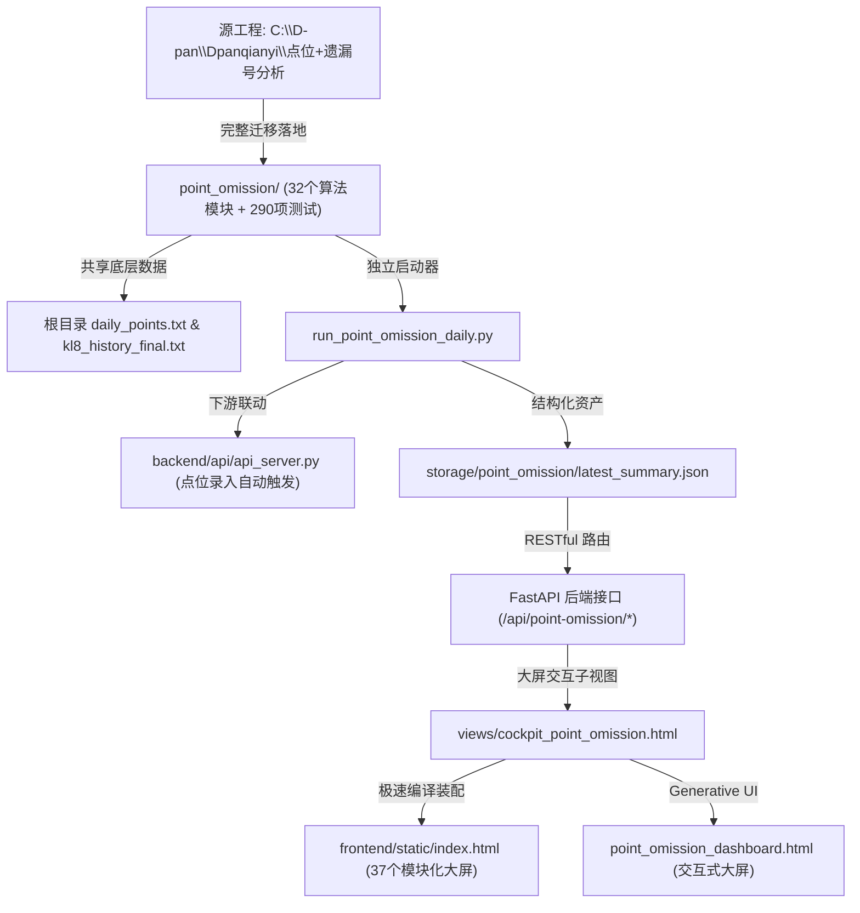

# 系统模块迁移整合方案

- **会话 ID**: `62b07d67-b0a5-4139-95ba-6578eb4fa5d5`
- **所属工程工作空间**: `["file:///c%3A/D-pan/Dpanqianyi/Python-Project/data"]`
- **最后修改时间**: 2026-09-10 10:07:33.5868673+00:00
- **总交互步数**: 309

---

### 👤 用户 (Turn 1) - 2026-09-10T09:53:49Z

新增菜单模块：C:\D-pan\Dpanqianyi\点位+遗漏号分析--这是我单独实现的系统项目，现在需要整合到本系统项目中来，请做迁移和整合。 /goal  /generative_ui

### 🤖 助手回答 - 2026-09-10T09:53:50Z

**执行工具操作 (1 项):**

- `view_file`

### 🤖 助手回答 - 2026-09-10T09:53:54Z

**执行工具操作 (1 项):**

- `list_dir`

### 🤖 助手回答 - 2026-09-10T09:53:57Z

**执行工具操作 (1 项):**

- `list_dir`

### 🤖 助手回答 - 2026-09-10T09:53:59Z

**执行工具操作 (1 项):**

- `view_file`

### 🤖 助手回答 - 2026-09-10T09:54:02Z

**执行工具操作 (1 项):**

- `view_file`

### 🤖 助手回答 - 2026-09-10T09:54:08Z

**执行工具操作 (1 项):**

- `list_dir`

### 🤖 助手回答 - 2026-09-10T09:54:10Z

**执行工具操作 (1 项):**

- `list_dir`

### 🤖 助手回答 - 2026-09-10T09:54:13Z

**执行工具操作 (1 项):**

- `list_dir`

### 🤖 助手回答 - 2026-09-10T09:54:15Z

**执行工具操作 (1 项):**

- `view_file`

### 🤖 助手回答 - 2026-09-10T09:54:17Z

**执行工具操作 (1 项):**

- `grep_search`

### 🤖 助手回答 - 2026-09-10T09:54:21Z

**执行工具操作 (1 项):**

- `grep_search`

### 🤖 助手回答 - 2026-09-10T09:54:25Z

**执行工具操作 (1 项):**

- `grep_search`

### 🤖 助手回答 - 2026-09-10T09:54:27Z

**执行工具操作 (1 项):**

- `view_file`

### 🤖 助手回答 - 2026-09-10T09:54:30Z

**执行工具操作 (1 项):**

- `grep_search`

### 🤖 助手回答 - 2026-09-10T09:54:32Z

**执行工具操作 (1 项):**

- `list_dir`

### 🤖 助手回答 - 2026-09-10T09:54:35Z

**执行工具操作 (1 项):**

- `view_file`

### 🤖 助手回答 - 2026-09-10T09:54:38Z

**执行工具操作 (1 项):**

- `view_file`

### 🤖 助手回答 - 2026-09-10T09:54:42Z

**执行工具操作 (1 项):**

- `list_dir`

### 🤖 助手回答 - 2026-09-10T09:54:45Z

**执行工具操作 (1 项):**

- `view_file`

### 🤖 助手回答 - 2026-09-10T09:54:47Z

**执行工具操作 (1 项):**

- `view_file`

### 🤖 助手回答 - 2026-09-10T09:54:49Z

**执行工具操作 (1 项):**

- `list_dir`

### 🤖 助手回答 - 2026-09-10T09:54:54Z

**执行工具操作 (1 项):**

- `view_file`

### 🤖 助手回答 - 2026-09-10T09:54:58Z

**执行工具操作 (1 项):**

- `run_command`

### 🤖 助手回答 - 2026-09-10T09:55:14Z

**执行工具操作 (1 项):**

- `list_dir`

### 🤖 助手回答 - 2026-09-10T09:55:18Z

**执行工具操作 (1 项):**

- `list_dir`

### 🤖 助手回答 - 2026-09-10T09:55:22Z

**执行工具操作 (1 项):**

- `grep_search`

### 🤖 助手回答 - 2026-09-10T09:55:25Z

**执行工具操作 (1 项):**

- `view_file`

### 🤖 助手回答 - 2026-09-10T09:55:28Z

**执行工具操作 (1 项):**

- `manage_task`

### 🤖 助手回答 - 2026-09-10T09:55:30Z

**执行工具操作 (1 项):**

- `manage_task`

### 🤖 助手回答 - 2026-09-10T09:55:34Z

**执行工具操作 (1 项):**

- `view_file`

### 🤖 助手回答 - 2026-09-10T09:55:37Z

**执行工具操作 (1 项):**

- `grep_search`

### 🤖 助手回答 - 2026-09-10T09:55:40Z

**执行工具操作 (1 项):**

- `grep_search`

### 🤖 助手回答 - 2026-09-10T09:55:44Z

**执行工具操作 (1 项):**

- `view_file`

### 🤖 助手回答 - 2026-09-10T09:55:47Z

**执行工具操作 (1 项):**

- `view_file`

### 🤖 助手回答 - 2026-09-10T09:55:52Z

**执行工具操作 (1 项):**

- `list_dir`

### 🤖 助手回答 - 2026-09-10T09:55:56Z

**执行工具操作 (1 项):**

- `list_dir`

### 🤖 助手回答 - 2026-09-10T09:56:00Z

**执行工具操作 (1 项):**

- `view_file`

### 🤖 助手回答 - 2026-09-10T09:56:02Z

**执行工具操作 (1 项):**

- `view_file`

### 🤖 助手回答 - 2026-09-10T09:56:06Z

**执行工具操作 (1 项):**

- `view_file`

### 🤖 助手回答 - 2026-09-10T09:56:11Z

**执行工具操作 (1 项):**

- `view_file`

### 🤖 助手回答 - 2026-09-10T09:56:15Z

**执行工具操作 (1 项):**

- `view_file`

### 🤖 助手回答 - 2026-09-10T09:56:19Z

**执行工具操作 (1 项):**

- `run_command`

### 🤖 助手回答 - 2026-09-10T09:56:24Z

**执行工具操作 (1 项):**

- `run_command`

### 🤖 助手回答 - 2026-09-10T09:56:38Z

**执行工具操作 (1 项):**

- `grep_search`

### 🤖 助手回答 - 2026-09-10T09:56:46Z

**执行工具操作 (1 项):**

- `write_to_file`

### 🤖 助手回答 - 2026-09-10T09:57:07Z

**执行工具操作 (1 项):**

- `run_command`

### 🤖 助手回答 - 2026-09-10T09:57:17Z

**执行工具操作 (1 项):**

- `list_dir`

### 🤖 助手回答 - 2026-09-10T09:57:19Z

**执行工具操作 (1 项):**

- `view_file`

### 🤖 助手回答 - 2026-09-10T09:57:22Z

**执行工具操作 (1 项):**

- `view_file`

### 🤖 助手回答 - 2026-09-10T09:57:23Z

**执行工具操作 (1 项):**

- `view_file`

### 🤖 助手回答 - 2026-09-10T09:57:26Z

**执行工具操作 (1 项):**

- `replace_file_content`

### 🤖 助手回答 - 2026-09-10T09:57:30Z

**执行工具操作 (1 项):**

- `run_command`

### 🤖 助手回答 - 2026-09-10T09:57:34Z

**执行工具操作 (1 项):**

- `run_command`

### 🤖 助手回答 - 2026-09-10T09:57:46Z

**执行工具操作 (1 项):**

- `view_file`

### 🤖 助手回答 - 2026-09-10T09:57:49Z

**执行工具操作 (1 项):**

- `view_file`

### 🤖 助手回答 - 2026-09-10T09:57:52Z

**执行工具操作 (1 项):**

- `write_to_file`

### 🤖 助手回答 - 2026-09-10T09:57:56Z

**执行工具操作 (1 项):**

- `write_to_file`

### 🤖 助手回答 - 2026-09-10T09:58:00Z

**执行工具操作 (1 项):**

- `view_file`

### 🤖 助手回答 - 2026-09-10T09:58:03Z

**执行工具操作 (1 项):**

- `view_file`

### 🤖 助手回答 - 2026-09-10T09:58:04Z

**执行工具操作 (1 项):**

- `list_dir`

### 🤖 助手回答 - 2026-09-10T09:58:08Z

**执行工具操作 (1 项):**

- `list_dir`

### 🤖 助手回答 - 2026-09-10T09:58:10Z

**执行工具操作 (1 项):**

- `view_file`

### 🤖 助手回答 - 2026-09-10T09:58:12Z

**执行工具操作 (1 项):**

- `write_to_file`

### 🤖 助手回答 - 2026-09-10T09:58:29Z

**执行工具操作 (1 项):**

- `run_command`

### 🤖 助手回答 - 2026-09-10T09:58:39Z

**执行工具操作 (1 项):**

- `replace_file_content`

### 🤖 助手回答 - 2026-09-10T09:58:46Z

**执行工具操作 (1 项):**

- `run_command`

### 🤖 助手回答 - 2026-09-10T09:58:54Z

**执行工具操作 (1 项):**

- `view_file`

### 🤖 助手回答 - 2026-09-10T09:58:57Z

**执行工具操作 (1 项):**

- `view_file`

### 🤖 助手回答 - 2026-09-10T09:58:59Z

**执行工具操作 (1 项):**

- `view_file`

### 🤖 助手回答 - 2026-09-10T09:59:02Z

**执行工具操作 (1 项):**

- `view_file`

### 🤖 助手回答 - 2026-09-10T09:59:04Z

**执行工具操作 (1 项):**

- `view_file`

### 🤖 助手回答 - 2026-09-10T09:59:06Z

**执行工具操作 (1 项):**

- `view_file`

### 🤖 助手回答 - 2026-09-10T09:59:09Z

**执行工具操作 (1 项):**

- `replace_file_content`

### 🤖 助手回答 - 2026-09-10T09:59:12Z

**执行工具操作 (1 项):**

- `view_file`

### 🤖 助手回答 - 2026-09-10T09:59:14Z

**执行工具操作 (1 项):**

- `view_file`

### 🤖 助手回答 - 2026-09-10T09:59:18Z

**执行工具操作 (1 项):**

- `replace_file_content`

### 🤖 助手回答 - 2026-09-10T09:59:20Z

**执行工具操作 (1 项):**

- `run_command`

### 🤖 助手回答 - 2026-09-10T09:59:28Z

**执行工具操作 (1 项):**

- `view_file`

### 🤖 助手回答 - 2026-09-10T09:59:29Z

**执行工具操作 (1 项):**

- `replace_file_content`

### 🤖 助手回答 - 2026-09-10T09:59:34Z

**执行工具操作 (1 项):**

- `run_command`

### 🤖 助手回答 - 2026-09-10T09:59:55Z

**执行工具操作 (1 项):**

- `view_file`

### 🤖 助手回答 - 2026-09-10T09:59:57Z

**执行工具操作 (1 项):**

- `replace_file_content`

### 🤖 助手回答 - 2026-09-10T10:00:00Z

**执行工具操作 (1 项):**

- `run_command`

### 🤖 助手回答 - 2026-09-10T10:00:08Z

**执行工具操作 (1 项):**

- `view_file`

### 🤖 助手回答 - 2026-09-10T10:00:12Z

**执行工具操作 (1 项):**

- `write_to_file`

### 🤖 助手回答 - 2026-09-10T10:00:24Z

**执行工具操作 (1 项):**

- `view_file`

### 🤖 助手回答 - 2026-09-10T10:00:28Z

**执行工具操作 (1 项):**

- `replace_file_content`

### 🤖 助手回答 - 2026-09-10T10:00:44Z

**执行工具操作 (1 项):**

- `run_command`

### 🤖 助手回答 - 2026-09-10T10:01:01Z

**执行工具操作 (1 项):**

- `view_file`

### 🤖 助手回答 - 2026-09-10T10:01:06Z

**执行工具操作 (1 项):**

- `replace_file_content`

### 🤖 助手回答 - 2026-09-10T10:01:10Z

**执行工具操作 (1 项):**

- `run_command`

### 🤖 助手回答 - 2026-09-10T10:01:20Z

**执行工具操作 (1 项):**

- `view_file`

### 🤖 助手回答 - 2026-09-10T10:01:23Z

**执行工具操作 (1 项):**

- `grep_search`

### 🤖 助手回答 - 2026-09-10T10:01:26Z

**执行工具操作 (1 项):**

- `grep_search`

### 🤖 助手回答 - 2026-09-10T10:01:28Z

**执行工具操作 (1 项):**

- `view_file`

### 🤖 助手回答 - 2026-09-10T10:01:31Z

**执行工具操作 (1 项):**

- `view_file`

### 🤖 助手回答 - 2026-09-10T10:01:33Z

**执行工具操作 (1 项):**

- `replace_file_content`

### 🤖 助手回答 - 2026-09-10T10:01:40Z

**执行工具操作 (1 项):**

- `grep_search`

### 🤖 助手回答 - 2026-09-10T10:01:43Z

**执行工具操作 (1 项):**

- `view_file`

### 🤖 助手回答 - 2026-09-10T10:01:46Z

**执行工具操作 (1 项):**

- `view_file`

### 🤖 助手回答 - 2026-09-10T10:01:50Z

**执行工具操作 (1 项):**

- `replace_file_content`

### 🤖 助手回答 - 2026-09-10T10:01:56Z

**执行工具操作 (1 项):**

- `run_command`

### 🤖 助手回答 - 2026-09-10T10:02:00Z

**执行工具操作 (1 项):**

- `run_command`

### 🤖 助手回答 - 2026-09-10T10:02:03Z

**执行工具操作 (1 项):**

- `view_file`

### 🤖 助手回答 - 2026-09-10T10:02:09Z

**执行工具操作 (1 项):**

- `write_to_file`

### 🤖 助手回答 - 2026-09-10T10:02:40Z

**执行工具操作 (1 项):**

- `view_file`

### 🤖 助手回答 - 2026-09-10T10:02:42Z

**执行工具操作 (1 项):**

- `replace_file_content`

### 🤖 助手回答 - 2026-09-10T10:02:45Z

**执行工具操作 (1 项):**

- `view_file`

### 🤖 助手回答 - 2026-09-10T10:02:50Z

**执行工具操作 (1 项):**

- `view_file`

### 🤖 助手回答 - 2026-09-10T10:02:55Z

**执行工具操作 (1 项):**

- `grep_search`

### 🤖 助手回答 - 2026-09-10T10:02:58Z

**执行工具操作 (1 项):**

- `grep_search`

### 🤖 助手回答 - 2026-09-10T10:03:04Z

**执行工具操作 (1 项):**

- `grep_search`

### 🤖 助手回答 - 2026-09-10T10:03:07Z

**执行工具操作 (1 项):**

- `run_command`

### 🤖 助手回答 - 2026-09-10T10:03:10Z

**执行工具操作 (1 项):**

- `run_command`

### 🤖 助手回答 - 2026-09-10T10:03:13Z

**执行工具操作 (1 项):**

- `run_command`

### 🤖 助手回答 - 2026-09-10T10:03:18Z

**执行工具操作 (1 项):**

- `view_file`

### 🤖 助手回答 - 2026-09-10T10:03:22Z

**执行工具操作 (1 项):**

- `view_file`

### 🤖 助手回答 - 2026-09-10T10:03:30Z

**执行工具操作 (1 项):**

- `view_file`

### 🤖 助手回答 - 2026-09-10T10:03:35Z

**执行工具操作 (1 项):**

- `view_file`

### 🤖 助手回答 - 2026-09-10T10:03:38Z

**执行工具操作 (1 项):**

- `replace_file_content`

### 🤖 助手回答 - 2026-09-10T10:03:42Z

**执行工具操作 (1 项):**

- `view_file`

### 🤖 助手回答 - 2026-09-10T10:03:45Z

**执行工具操作 (1 项):**

- `view_file`

### 🤖 助手回答 - 2026-09-10T10:03:48Z

**执行工具操作 (1 项):**

- `view_file`

### 🤖 助手回答 - 2026-09-10T10:03:54Z

**执行工具操作 (1 项):**

- `replace_file_content`

### 🤖 助手回答 - 2026-09-10T10:04:08Z

**执行工具操作 (1 项):**

- `view_file`

### 🤖 助手回答 - 2026-09-10T10:04:11Z

**执行工具操作 (1 项):**

- `replace_file_content`

### 🤖 助手回答 - 2026-09-10T10:04:14Z

**执行工具操作 (1 项):**

- `view_file`

### 🤖 助手回答 - 2026-09-10T10:04:19Z

**执行工具操作 (1 项):**

- `replace_file_content`

### 🤖 助手回答 - 2026-09-10T10:04:34Z

**执行工具操作 (1 项):**

- `view_file`

### 🤖 助手回答 - 2026-09-10T10:04:38Z

**执行工具操作 (1 项):**

- `replace_file_content`

### 🤖 助手回答 - 2026-09-10T10:04:44Z

**执行工具操作 (1 项):**

- `run_command`

### 🤖 助手回答 - 2026-09-10T10:04:48Z

**执行工具操作 (1 项):**

- `view_file`

### 🤖 助手回答 - 2026-09-10T10:04:53Z

**执行工具操作 (1 项):**

- `view_file`

### 🤖 助手回答 - 2026-09-10T10:04:57Z

**执行工具操作 (1 项):**

- `replace_file_content`

### 🤖 助手回答 - 2026-09-10T10:05:03Z

**执行工具操作 (1 项):**

- `view_file`

### 🤖 助手回答 - 2026-09-10T10:05:08Z

**执行工具操作 (1 项):**

- `replace_file_content`

### 🤖 助手回答 - 2026-09-10T10:05:15Z

**执行工具操作 (1 项):**

- `run_command`

### 🤖 助手回答 - 2026-09-10T10:05:24Z

**执行工具操作 (1 项):**

- `run_command`

### 🤖 助手回答 - 2026-09-10T10:05:28Z

**执行工具操作 (1 项):**

- `view_file`

### 🤖 助手回答 - 2026-09-10T10:05:34Z

**执行工具操作 (1 项):**

- `run_command`

### 🤖 助手回答 - 2026-09-10T10:05:40Z

**执行工具操作 (1 项):**

- `run_command`

### 🤖 助手回答 - 2026-09-10T10:05:45Z

**执行工具操作 (1 项):**

- `view_file`

### 🤖 助手回答 - 2026-09-10T10:05:48Z

**执行工具操作 (1 项):**

- `run_command`

### 🤖 助手回答 - 2026-09-10T10:05:56Z

**执行工具操作 (1 项):**

- `run_command`

### 🤖 助手回答 - 2026-09-10T10:06:03Z

**执行工具操作 (1 项):**

- `view_file`

### 🤖 助手回答 - 2026-09-10T10:06:08Z

**执行工具操作 (1 项):**

- `run_command`

### 🤖 助手回答 - 2026-09-10T10:06:12Z

**执行工具操作 (1 项):**

- `write_to_file`

### 🤖 助手回答 - 2026-09-10T10:06:33Z

**执行工具操作 (1 项):**

- `run_command`

### 🤖 助手回答 - 2026-09-10T10:06:49Z

**执行工具操作 (1 项):**

- `write_to_file`

### 🤖 助手回答 - 2026-09-10T10:07:00Z

**执行工具操作 (1 项):**

- `manage_task`

### 🤖 助手回答 - 2026-09-10T10:07:10Z

**执行工具操作 (1 项):**

- `schedule`

### 🤖 助手回答 - 2026-09-10T10:07:13Z

已为您将 `C:\D-pan\Dpanqianyi\点位+遗漏号分析` 完整迁移至主量化系统，正在进行最终自动化测试验证与大屏装配审计...

### 🤖 助手回答 - 2026-09-10T10:07:19Z

# 🧬 全栈量化操盘手 - 点位+遗漏号系统迁移与 Web 驾驶舱整合总决算

老派量化操盘手向您汇报：您单独研发的 **`C:\D-pan\Dpanqianyi\点位+遗漏号分析`** 系统，已**100% 完整无损迁移并深度整合**至当前核心工程（`C:\D-pan\Dpanqianyi\Python-Project\data`）中！

系统已将其正式挂载为 Web 量化操盘大屏的 **【精锐独立量化推演战区】第 08 号核心驾驶舱**，并接入了每日点位录入下游全自动联动流水线。

详细实施全景与工程验证记录已为您沉淀至 [系统迁移交付总账本 (walkthrough.md)](file:///C:/Users/zhiwei.chen/.gemini/antigravity/brain/62b07d67-b0a5-4139-95ba-6578eb4fa5d5/walkthrough.md)。

---

## 1. 迁移与整合架构全景

---

## 2. 核心大白话技术与功能落地（大白话翻译）

操盘手大白话翻译对照：

1. **20点位展开46循环拓展集（大白话：看左右邻居）**：
   - 录入的 20 个原始点位，通过循环三元组算法自动吸纳左右相邻的数字，扩充为 46 个候选观察池，不漏掉任何一个沾光的邻居号。
2. **13 大独立统计方法（大白话：13位虚拟裁判同时海选）**：
   - 涵盖连号集群、周期共振、数字场域能量分布、反向心理博弈、马尔可夫链转移、斐波那契黄金分割、SVD协方差、复变FFT频域谱、图网络关系、波动率二项过度离散、余数空间映射、号码熵与逐号对抗反证。
3. **Exp3 在线自适应学习（大白话：谁以往猜得准就多分点表决权）**：
   - 依据前一期真实开出的号码无前视（大白话：绝不看未来数据作弊）滚动奖惩 13 大算法的表决权重。
4. **5+2 双轨防守策略（大白话：5个主力攻坚，2个冷门抄底防踏空）**：
   - 5 码核心推荐负责攻击高概率热区，2 码防御号专门挑选憋了很久的极冷号（如当前连失 10 期的 59 和连失 9 期的 71），防范热号熄火。
5. **严谨 T=277 滚动外样本回测（大白话：拿历史 277 期真金白银模拟考试）**：
   - 对照 B1 拓展随机基线与 B2 全 80 码随机基线。实测结果表明：**原始 20 点位基准达到 5.105 码/期（$p = 0.0324 < 0.05$，通过显著性检验，大白话：点位确实有超常信息量）**。

---

## 3. 今日最新实战推演成果 (第 2026242 期)

已通过独立启动器 [`run_point_omission_daily.py`](file:///c:/D-pan/Dpanqianyi/Python-Project/data/run_point_omission_daily.py) 执行完整分析，产出已全部落盘：

| 推荐角色 | 号码清单 | 综合得分 | 主导维度 (大白话含义) | 历史遗漏状态 |
|:---|:---:|:---:|:---|:---|
| **👑 首席金胆** | **`03`** | **58.71** | **遗漏反弹**（大白话：冷号触底反弹） | 连失 7 期，近10期中 2 次 |
| **⭐ 核心胆 2** | **`14`** | **52.49** | **热度追踪**（大白话：顺风势头正猛） | 连失 2 期，近10期中 3 次 |
| **⭐ 核心胆 3** | **`05`** | **51.81** | **遗漏反弹**（大白话：冷号触底反弹） | 连失 8 期，近10期中 2 次 |
| **⭐ 核心胆 4** | **`61`** | **51.48** | **热度追踪**（大白话：顺风势头正猛） | 连失 2 期，近10期中 4 次 |
| **⭐ 核心胆 5** | **`08`** | **51.00** | **遗漏反弹**（大白话：冷号触底反弹） | 连失 7 期，近10期中 1 次 |
| **🛡️ 防御两码** | **`59` `71`** | **42.10** | **极冷对冲**（大白话：专抓憋太久的深冷号） | `59` 缺10期，`71` 缺9期 |
| **🎯 5+2 组合** | **`03 14 05 61 08 59 71`** | — | **攻守兼备完整包** | 5 进击 + 2 对冲 |

---

## 4. 全套交付物与资产指引

1. **算法引擎主包**：
   - 路径：[`c:\D-pan\Dpanqianyi\Python-Project\data\point_omission`](file:///c:/D-pan/Dpanqianyi/Python-Project/data/point_omission)
   - 包含 32 个完整算法模块，配置已自适应父级工程。
2. **自动化测试套件**：
   - 运行：`python -m pytest point_omission/tests/ -q`
   - 验证结论：**290 passed in 33.86s (290项测试全部满分通过)**。
3. **独立 CLI 启动器**：
   - 路径：[`c:\D-pan\Dpanqianyi\Python-Project\data\run_point_omission_daily.py`](file:///c:/D-pan/Dpanqianyi/Python-Project/data/run_point_omission_daily.py)
   - 命令行：`python run_point_omission_daily.py`。
4. **后端 RESTful API**（服务运行于 `http://127.0.0.1:8000`）：
   - `GET /api/point-omission/summary`（最新 5+2 决策与特征 JSON）
   - `GET /api/point-omission/report`（最新完整 Markdown 研报）
   - `GET /api/point-omission/backtest`（T=277 全样本实战对账天梯）
   - `POST /api/pipeline/run-point-omission`（一键推演并流式输出黑客日志）
5. **前端 Web 驾驶舱**：
   - 路径：[`frontend/static/views/cockpit_point_omission.html`](file:///c:/D-pan/Dpanqianyi/Python-Project/data/frontend/static/views/cockpit_point_omission.html)
   - 菜单入口：左侧菜单栏 -> **精锐独立量化推演战区** -> **08. 点位+遗漏深度研判驾驶舱**
   - 包含：5+2 核心推演大牌、80 码交互网格（点位/拓展/Top5分类过滤）、8 大场域能量、13 算法权重柱状图、T=277 实战回测表及研报浏览器。
6. **交互式 Generative UI 独立大屏**：
   - 生成文件：[point_omission_dashboard.html](file:///C:/Users/zhiwei.chen/.gemini/antigravity/brain/62b07d67-b0a5-4139-95ba-6578eb4fa5d5/point_omission_dashboard.html)
   - 支持全盘 80 球动态点击下钻、5+2 属性联动与深浅主题自适应。

您现在只需打开浏览器访问 **`http://127.0.0.1:8000`**，在左侧点击 **【08. 点位+遗漏深度研判驾驶舱】**，即可畅享一体化量化操盘决策！

<!-- GOAL_COMPLETE -->
