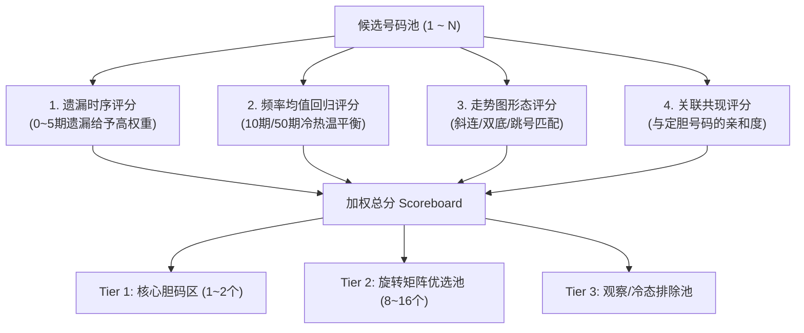

# 《彩票中奖指南：与大奖有约》核心规则、数学模型与策略解析

> **文档来源**：原著《彩票中奖指南：与大奖有约》（Gail Howard 著）  
> **解析引擎**：方案 B（流式中缝拆切 + RapidOCR 视觉文档解析 + 结构化规则提炼）  
> **生成时间**：2026年  
> **文件归档**：`C:\D-pan\Dpanqianyi\sijing\彩票中奖指南_核心规则与策略解析.md`

---

## 目录
1. [书籍概况与核心理念](#一-书籍概况与核心理念)
2. [核心选号理论：平衡选号模型 (Balanced Game Theory)](#二-核心选号理论平衡选号模型-balanced-game-theory)
3. [时序趋势分析与图表系统 (Trend Analysis & Charting)](#三-时序趋势分析与图表系统-trend-analysis--charting)
4. [核心武器：聪明组合（旋转矩阵系统 Smart Luck Wheels）](#四-核心武器聪明组合旋转矩阵系统-smart-luck-wheels)
5. [综合决策算法：最佳号码记分板 (Best Number Scoreboard)](#五-综合决策算法最佳号码记分板-best-number-scoreboard)
6. [负面过滤准则：必须规避的投注陷阱](#六-负面过滤准则必须规避的投注陷阱)
7. [特定玩法实战要点（选6型、选5型、双区复合型）](#七-特定玩法实战要点选6型选5型双区复合型)
8. [策略系统化与代码落地接口设计](#八-策略系统化与代码落地接口设计)

---

## 一、 书籍概况与核心理念

### 1.1 背景与宗旨
本书作者**盖尔·霍华德（Gail Howard）**被公认为现代科学彩票学（Lottery Science）的奠基人，创造了“聪明组合（Smart Luck Wheels）”与“平衡选号（Balanced Game Theory）”两大体系，累计造就数十位百万大奖得主。

* **核心命题**：摇奖数字在物理上是随机的，但组合形态在大样本统计下呈现**极强的数学聚类与回归规律**。
* **博彩哲学**：
  $$\\text{中奖期望} = \\text{运气} \\times \\text{数学策略} \\times \\text{资金管理}$$
  彩票不是盲目碰运气的赌博，而是通过数据分析排除 90% 以上的小概率异常形态，将有限资金聚焦于最高频出现的“黄金概率区间”。

---

## 二、 核心选号理论：平衡选号模型 (Balanced Game Theory)

平衡选号法通过对历史海量开奖数据的统计，提炼出 5 大核心平衡指标：

### 2.1 奇偶平衡分布律 (Odd-Even Ratio)
在选 6 型（如 6/49、6/33）或选 5 型彩票中，极端的全奇或全偶形态出现概率极低（< 1.5%）。

| 奇偶比例 (奇:偶) | 历史覆盖率 | 策略建议 |
| :--- | :--- | :--- |
| **3 : 3** | **约 33.3%** | 🟢 **核心优选** |
| **2 : 4 或 4 : 2** | **约 48.0%** | 🟢 **核心优选** |
| **1 : 5 或 5 : 1** | 约 14.5% | 🟡 次选 / 限制使用 |
| **0 : 6 或 6 : 0** | **< 1.5%** | 🔴 **坚决过滤剔除** |

> **过滤规则 1**：确保每一注号码的奇数与偶数比例必须落在 `2:4`、`3:3` 或 `4:2` 中（覆盖 81% 以上的开奖形态）。

---

### 2.2 大小号平衡分布律 (High-Low Ratio)
将整个待选号码池按中位数切分为前半区（小号）和后半区（大号）。
例如 6/49 中，小号为 `01~24`，大号为 `25~49`。

* **高频区间**：
  * 3大 3小（占比约 33%）
  * 2大 4小 或 4大 2小（占比约 48%）
* **过滤规则 2**：剔除 6大0小、0大6小、5大1小、1大5小 等失衡形态。

---

### 2.3 和值（Sum）黄金钟形分布
中奖号码的和值呈现标准正态分布（钟形曲线）。

#### 和值中心期望计算公式：
$$\\text{理论平均和值 } \\mu = \\frac{k \\times (1 + N)}{2}$$
* $k$：每注号码个数（选6型 $k=6$，选5型 $k=5$）
* $N$：待选数字总数（如 49 或 33）

以 6/49 彩票为例：
$$\\mu = \\frac{6 \\times (1 + 49)}{2} = 150$$

#### 70% 黄金中奖和值区间：
$$[\\mu - 35, \\; \\mu + 35] \\implies [115, \\; 185]$$

> **过滤规则 3**：任何号码组合的和值若低于区间下限（过小）或高于区间上限（过大），直接在预处理阶段予以剔除。

---

### 2.4 相邻号（连号）与同尾数规律
* **连号规律**：历史上超过 **55% ~ 65%** 的开奖期数中包含至少一组 2 连号（如 14-15），但 3 连号以上出现率显著下降（< 4%），4 连号极罕见。
* **同尾数规律**：每期号码中出现 2 个相同个位数（如 03, 23 或 17, 37）的概率高达 **70%**。

---

## 三、 时序趋势分析与图表系统 (Trend Analysis & Charting)

### 3.1 遗漏图表与冷热周期 (Skip Charts)
定义数字距离上一次开奖所间隔的期数为**遗漏值（Skip）**：

```
遗漏值 = 0  -> 上期刚开出（重号/连出号）
遗漏值 = 1  -> 隔1期开出
...
遗漏值 >= 10 -> 冷号（长遗漏）
```

#### 遗漏分布统计概率（基于 7000+ 期数据分析）：
* **遗漏 0 期（重号）**：平均每期占比约 **12% ~ 15%**（即每期开奖通常有 1 个来自上期号码）。
* **遗漏 1 ~ 3 期（近期热号）**：累计贡献超过 **50%** 的中奖号码。
* **遗漏 0 ~ 5 期（黄金出号区）**：贡献全书中奖数字的 **70% 以上**。
* **大遗漏（>= 10期）**：每期通常仅出现 0~1 个，不会集中爆发。

---

### 3.2 典型走势形态识别
1. **双底 / 三倍底形态（Double/Triple Bottom）**：
   * 某号码在连续两次相同遗漏期数（如均在遗漏 5 期时开出）后，再次达到该遗漏值时，反弹概率激增。
2. **斜连号牵引（Slanted Hits）**：
   * 走势图上呈现 $N-1 \\rightarrow N \\rightarrow N+1$ 的对角线递进趋势。
3. **伴侣号/成对出现（Pairing Tendency）**：
   * 某些特定数字对（Affinity Pairs）在统计上呈现高度的正相关共现性。

---

## 四、 核心武器：聪明组合（旋转矩阵系统 Smart Luck Wheels）

### 4.1 核心数学原理
如果彩民看好 12 个号码，选 6 型的完全组合需要：
$$C(12, 6) = \\frac{12!}{6! \\times 6!} = 924 \\text{ 注（成本极高）}$$

盖尔·霍华德通过**组合覆盖设计（Combinatorial Covering Design / Steiner Systems）**，构建旋转矩阵，在大幅削减注数的前提下，提供**严格的数学保奖承诺**。

---

### 4.2 旋转矩阵中奖保证分类

| 保证类型 | 含义说明 | 相比全组合节省成本 |
| :--- | :--- | :--- |
| **5 选 5 中 (5-if-5)** | 若所选号码池中包含 5 个开奖号，**100% 保证至少中 1 注 5 等奖** | 节省 **75% ~ 85%** |
| **5 选 4 中 (4-if-5)** | 若包含 5 个开奖号，100% 保证至少中 1 注 4 等奖 | 节省 **90% ~ 95%** |
| **4 选 4 中 (4-if-4)** | 若包含 4 个开奖号，100% 保证至少中 1 注 4 等奖 | 节省 **95% ~ 98%** |
| **4 选 3 中 (3-if-4)** | 若包含 4 个开奖号，100% 保证至少中 1 注 3 等奖 | 超低成本覆盖大号码池 |

---

### 4.3 经典旋转矩阵示例（7 个号码 5 选 5 中 —— 聪明组合 #201）
* **候选号码位置**：`A, B, C, D, E, F, G`（共 7 个自选号码）
* **注数**：仅需 **6 注**（完全组合需 7 注，更大号码池下削减比呈指数级倍增）

```
注 1:  A  B  C  D  E  F
注 2:  A  B  C  D  E  G
注 3:  A  B  C  D  F  G
注 4:  A  B  C  E  F  G
注 5:  A  B  D  E  F  G
注 6:  A  C  D  E  F  G
```

---

### 4.4 幸运数字定胆组合（Power Numbers / Banker Wheels）
在矩阵中引入 1~2 个**定胆号码（Bankers）**：
* 设彩民极其看好数字 $D_1$ 和 $D_2$，将其固定在每一注中。
* 剩余位置由其他候选号码进行旋转。
* **收益杠杆**：若胆码全中，不仅保奖等级直接提升至一等奖/二等奖，注数成本还能再降低 **60% ~ 80%**。

---

## 五、 综合决策算法：最佳号码记分板 (Best Number Scoreboard)

为了避免单一指标的片面性，系统需采用多维度加权打分模型：



---

## 六、 负面过滤准则：必须规避的投注陷阱

全书明确列出彩民最常犯的 6 种低级投注陷阱（必须作为代码硬性过滤规则）：

1. ❌ **全连号 / 算术等差数列**（如 `05, 10, 15, 20, 25, 30` 或 `01, 02, 03, 04, 05, 06`）：极度浪费资金。
2. ❌ **过往已开出过的一等奖完全相同组合**：相同 6 个数字在数百年内重复出现的理论周期需数十万年。
3. ❌ **投注纸图形走势（对角线、十字形等几何图案）**：大量缺乏常识的彩民会画图案选号，导致一旦中奖奖金被数万人严重分摊。
4. ❌ **纯生日数字限制（全集中在 01~31 之间）**：完全丢失 32 以上大号区间，导致大小比严重失衡。
5. ❌ **极端全同尾数**（如 `07, 17, 27, 37, 47`）：实际出现率 < 0.001%。
6. ❌ **单一区间全部扎堆**（如全部挤在第一十位区间 `01~09`）。

---

## 七、 特定玩法实战要点

* **选 6 型彩票（如双色球红球 / 6/49）**：
  * 主推 `4选4中` 与 `5选4中` 矩阵，号码池控制在 12~18 个数字。
* **选 5 型彩票（如大乐透前区 / 5/35）**：
  * 主推 `4选3中` 与 `4选4中` 矩阵，奇偶比以 `3:2` 或 `2:3` 为主。
* **复合双区彩票（动力球 / Powerball / 双色球蓝球）**：
  * 主区运行旋转矩阵，次区（特别号/蓝球）依据冷热遗漏周期进行独立单轮定投。

---

## 八、 策略系统化与代码落地接口设计

可将本书的核心规则与模型无缝转换为自动化处理管道：

```python
# -*- coding: utf-8 -*-
"""
Gail Howard 科学选号与过滤管道架构示例
"""
from dataclasses import dataclass
from typing import List

@dataclass
class FilterConfig:
    sum_min: int = 115
    sum_max: int = 185
    allowed_odd_ratios: tuple = (2, 3, 4)      # 允许 2奇4偶、3奇3偶、4奇2偶
    allowed_high_ratios: tuple = (2, 3, 4)     # 允许 2大4小、3大3小、4大2小
    max_consecutive: int = 2                   # 最大允许连号个数（2连号）
    max_same_tail: int = 2                     # 最大允许同尾数个数

def validate_combination(comb: List[int], total_balls: int, config: FilterConfig) -> bool:
    # 1. 和值过滤
    s = sum(comb)
    if not (config.sum_min <= s <= config.sum_max):
        return False
    
    # 2. 奇偶比过滤
    odds = sum(1 for x in comb if x % 2 == 1)
    if odds not in config.allowed_odd_ratios:
        return False
    
    # 3. 大小比过滤
    mid = total_balls // 2
    highs = sum(1 for x in comb if x > mid)
    if highs not in config.allowed_high_ratios:
        return False
    
    # 4. 同尾数过滤
    tails = [x % 10 for x in comb]
    if max(tails.count(t) for t in tails) > config.max_same_tail:
        return False
        
    return True
```

---

### 总结
《彩票中奖指南》的核心价值在于**通过数学手段（正态分布、遗漏时序、矩阵覆盖）将博彩建立在概率优势与严格纪律之上**。本 Markdown 结构化整理了全书规则与参数，可直接用于后续算法建模、策略回测与系统开发。
