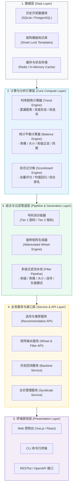
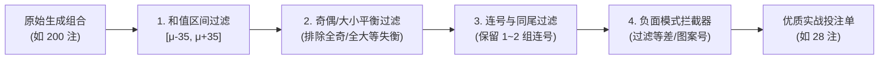
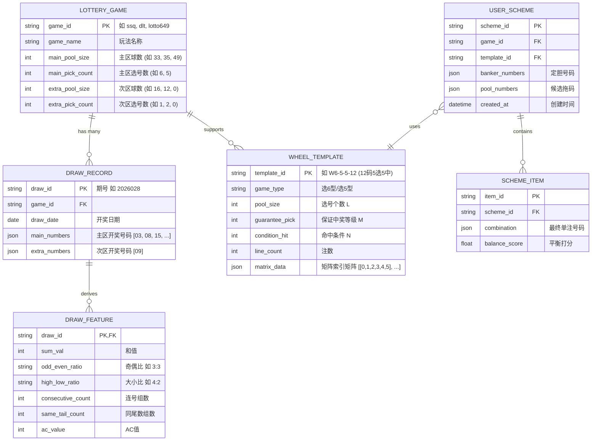

# 彩票科学选号与缩水分析系统 —— 系统架构设计文档 (SDD)

> **标准版本**：v1.0  
> **设计依据**：盖尔·霍华德（Gail Howard）《彩票中奖指南》核心理论体系  
> **归档位置**：`C:\D-pan\Dpanqianyi\sijing\彩票科学选号与缩水系统_系统架构设计文档(SDD).md`

---

## 1. 架构目标与设计原则

### 1.1 系统定位
本系统是一个集**开奖数据分析、时序趋势挖掘、多维度评分推荐、旋转矩阵组合优化、多级管道智能过滤与策略回测**于一体的工业级彩票科学决策与辅助缩水平台。

### 1.2 核心设计原则
* **高内聚低耦合 (High Cohesion & Low Coupling)**：采用管道与过滤器（Pipes & Filters）及策略模式，使过滤规则、评分算法和旋转矩阵独立可插拔。
* **高性能计算 (High Performance Computing)**：利用 NumPy / Polars 向量化矩阵运算与位运算（Bitmask），支持万级/十万级投注组合在 100ms 内完成全量过滤。
* **确定性保奖 (Guaranteed Covering)**：旋转矩阵模块严格遵循组合覆盖设计（Combinatorial Designs），确保满足保奖数学承诺。
* **数据驱动与闭环验证 (Data-Driven & Backtest)**：内置历史回测引擎，所有策略与评分模型均可进行无前瞻偏差（No Lookahead Bias）的历史检验。

---

## 2. 整体系统架构与技术拓扑

---

## 3. 核心子系统与功能模块设计

### 3.1 数据接入与特征库 (Data Ingestion Subsystem)
* **开奖历史抓取与校验**：定期自动同步全国开奖数据（双色球、大乐透、七星彩、快乐8、6/49等），确保数据的原子性与准确性。
* **基础特征派生**：开奖同时自动计算并持久化衍生特征（和值、奇偶比、大小比、连号组数、同尾组数、AC值、区间跨度）。

### 3.2 趋势与平衡分析引擎 (Trend & Balance Engine)
* **时序遗漏状态机 (Skip State Machine)**：
  * 维护每个球号的最新遗漏周期序列 $[S_0, S_1, S_2, \dots, S_k]$。
  * 计算平均遗漏值（Mean Skip）、中位数遗漏值（Median Skip）及当前偏离比（Current Skip / Mean Skip）。
* **形态识别器 (Pattern Recognizer)**：
  * 双底/多倍底识别：当连续两次遗漏值相同且再次达到该值时触发形态信号。
  * 斜连号识别：走势图对角线连续递进态势识别。
  * 伴侣共现阵列：计算号码之间的 Jaccard 相似度与共现亲和度。

### 3.3 最佳号码记分板决策系统 (Scoreboard Decision System)
综合多维度特征输出号码加权总分：
$$\text{TotalScore}(n) = w_1 \cdot S_{\text{skip}}(n) + w_2 \cdot S_{\text{momentum}}(n) + w_3 \cdot S_{\text{reversion}}(n) + w_4 \cdot S_{\text{affinity}}(n)$$
* 自动划分为三大梯队：
  * **Tier 1（胆码候选池 1~3个）**：高动量、强形态特征号码。
  * **Tier 2（拖码优选池 8~16个）**：平衡选号与高亲和度号码。
  * **Tier 3（排除池）**：极端冷态或超长遗漏衰退号码。

### 3.4 旋转矩阵与保奖核心 (Smart Luck Wheel Core)
* **模板驱动 (Template-Driven)**：内置 Gail Howard 经典旋转矩阵库（涵盖 5选5中、5选4中、4选4中、4选3中等标准设计）。
* **定胆注入器 (Banker Injector)**：支持固定胆码与动态拖码的交叉映射。
* **组合覆盖验证器 (Covering Verifier)**：验证任意开奖子集下是否 100% 达成指定中奖保证。

### 3.5 多级缩水过滤管道 (Filter Pipeline)
采用链式流水线设计（Chain of Responsibility Pattern）：

---

## 4. 数据库与数据模型设计 (ER Models)

---

## 5. 部署架构与性能保障

1. **计算复杂度控制**：
   * 旋转矩阵生成为 $O(N)$ 查表置换，耗时 $< 1\text{ms}$。
   * 过滤流水线采用 Bitwise 运算对 64-bit 整数执行快速 Mask 检查，10 万注过滤耗时 $< 20\text{ms}$。
2. **容灾与数据一致性**：
   * SQLite / PostgreSQL 每日自动备份。
   * 策略回测支持多进程并发加速（`multiprocessing.Pool`）。
